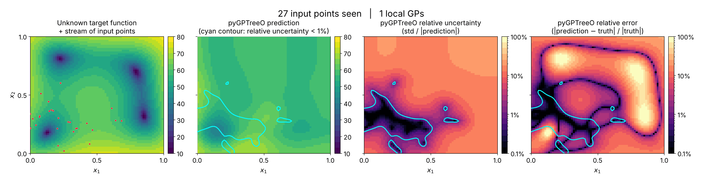

# pyGPTreeO: a Gaussian process tree for online regression



*pyGPTreeO learning a 2D target function (Himmelblau) online from a stream of input points, drawn from a cluster that moves across the input space. From left to right: the target function with the input points (most recent points in red), the pyGPTreeO prediction with the tree partition in white, the relative predictive uncertainty and the relative prediction error (logarithmic colour scales from 0.1% to 100%). The cyan contour encloses the region where the relative uncertainty is below 1%. The animation is generated by [`examples/make_readme_gif.py`](examples/make_readme_gif.py).*

## Introduction
pyGPTreeO is a Python tool designed for online/continual regression tasks. It implements a dynamically growing tree where each leaf node is a local Gaussian Process (GP) regressor. This structure makes it particularly well-suited for learning from data streams where data points arrive sequentially. It builds on the DLGP approach by Lederer et al (https://arxiv.org/abs/2006.09446) and our R package [GPTreeO](https://cran.r-project.org/web/packages/GPTreeO/index.html) (https://arxiv.org/abs/2410.01024).

## How it works (briefly)
- Using the sequential input stream, GPTreeO dynamically constructs a binary tree where each node represents a specific region of the input space.
- Leaf nodes contain their own Gaussian Process (GP) model, which is trained on the data points that fall into that node's defined region.
- When a leaf node accumulates a sufficient number of data points (determined by the `Nbar` parameter), it splits into two children. This process creates more specialized models for subregions of the data space.
- Predictions are typically made by the GP model in the leaf node into which a new data point falls. For overlapping regions (controlled by the `theta` parameter), predictions can be an aggregate prediction from multiple relevant GPs.

Interfaces to several established GP packages already exist, and the code can easily be extended with more. 


## Installation
Details on installing via pip will be added soon. For now, clone the repository and install it from there:
```bash
git clone https://github.com/anderkve/pygptreeo.git
cd pygptreeo
pip install -e .
```
The optional dependencies for the neural network global model (PyTorch) and for the GPyTorch interface can be installed with `pip install -e ".[neural]"` and `pip install -e ".[gpytorch]"`, respectively.

## Usage example
Here's a simple example of how to use GPTreeO:

```python
import numpy as np
from pygptreeo import GPTree

# 1. Initialize GPTree
# Nbar is the maximum number of points per leaf before it considers splitting.
# The leaf GPs are the default scikit-learn GPs; pass GPR=... to use your own.
gpt = GPTree(Nbar=50)

# 2. Prepare some data
# Let's create some 1D data for simplicity
X_train = np.linspace(0, 10, 100).reshape(-1, 1)
y_train = np.sin(X_train).ravel().reshape(-1, 1)

# 3. Feed data points to the tree sequentially
print("Training the GPTree...")
sigma = 1e-3  # observation noise (standard deviation) for each point
for i in range(len(X_train)):
    # GPTree expects 2D input for X and y for a single sample
    x_sample = X_train[i:i+1, :]
    y_sample = y_train[i:i+1, :]
    # update_tree(x, y, sigma): sigma is the observation-noise std for this point
    gpt.update_tree(x_sample, y_sample, sigma)
    if (i + 1) % 20 == 0:
        print(f"Processed {i+1}/{len(X_train)} points.")

# 4. Make predictions
print("\nMaking predictions...")
X_test = np.array([[0.5], [2.5], [5.5], [7.5], [9.5]])
y_pred, y_std = gpt.predict(X_test)

for i in range(len(X_test)):
    print(f"Input: {X_test[i,0]}, Prediction: {y_pred[i,0]:.4f}, StdDev: {y_std[i,0]:.4f}")

# The tree structure can be printed (optional, can be very large for many points)
# print("\nGPTree structure:")
# print(gpt.root)
```

## Adding many points at once

`update_tree` takes a single data point. A set of data points can be passed to `batch_update_tree`, which adds them to the tree one by one in the same way:

```python
gpt.batch_update_tree(X_train, y_train, sigma_train)   # arrays of shape (N, d), (N,) and (N,)
```

For a tree without data points there is also `fit`, which first builds the tree from all the data points and then trains each leaf GP once:

```python
gpt = GPTree(Nbar=50)
gpt.fit(X_train, y_train, sigma_train)
```

This is faster, by a factor of about 2.5 for 5000 points in our tests, with a similar accuracy. However, the uncertainty calibration is based on the predictions made for each point before it is added to the tree, so after `fit` the predicted uncertainties are the uncalibrated GP uncertainties. They become calibrated as further points are added with `update_tree` or `batch_update_tree`. `fit` raises an error for a tree that already holds data points.

## Selecting a leaf kernel

By default each leaf GP uses an anisotropic Matérn kernel, `ConstantKernel() * Matern(nu=1.5)`, with one length scale per input dimension. With the default setting `split_dimension_criteria='min_lengthscale'` a leaf is split along the dimension with the smallest length scale, i.e. the dimension along which the target function varies fastest. For kernels without per-dimension length scales the dimension with the largest spread in the data points is used instead.

For many target functions `AdditiveMaternKernel` is a better choice. It adds a low-order additive kernel, which models the target as a sum of main effects (`order=1`), or of main effects and pairwise interactions (`order=2`). It requires fewer data points when the target has approximately this structure, and there is typically little harm otherwise, except for a longer run time.

```python
from pygptreeo import GPTree, Default_GPR, AdditiveMaternKernel

d = 4  # input dimensionality
kernel = AdditiveMaternKernel(d=d, order=2, nu=1.5)
gpt = GPTree(GPR=Default_GPR(kernel=kernel, alpha=1e-6), Nbar=100)
```

If the target varies fastest along a combination of the inputs, e.g. for parameters with partly degenerate effects, use `GPR=Default_GPR(oblique=True)`. Each leaf can then learn length scales along combinations of the inputs, keeps them only if they lower its leave-one-out error, and is split across the direction of fastest variation. In our tests this lowered the error by a factor of up to 12 for such targets, at 1.1 to 5 times the run time.

Any other scikit-learn kernel can be used in the same way, e.g. `ConstantKernel() * (Matern(nu=1.5, length_scale=[1.0] * d) + RBF(length_scale=[1.0] * d))` as a cheaper alternative. For periodic inputs there is also `AdditivePeriodicMaternKernel(d=d)`, which is typically only beneficial when several oscillation periods fall within a single leaf.

## Multi-output targets

Set `n_outputs=p` and pass `y` and `sigma` as arrays with `p` columns. The `output_model` option determines how the outputs are modelled within each leaf:

- `'independent'` (default): One GP per output, each with its own kernel hyperparameters.
- `'shared'`: One GP with a single kernel for all outputs. The accuracy is similar when the outputs have similar length scales, at a small fraction of the run time.
- `'pca'`: The tree learns a global linear basis for the outputs by PCA, and each leaf models the leading components with one GP each. Suitable for strongly correlated outputs.
- `'aligned'`: As `'shared'`, for outputs that are a function on an ordered grid with features whose position depends on the inputs, e.g. a resonance peak or a kinematic edge. Each leaf stretches and compresses the grid of its curves so that their features line up, and keeps this alignment only if it lowers its leave-one-out error.

`'shared'` and `'aligned'` require the scikit-learn interface.

```python
gpt = GPTree(Nbar=100, n_outputs=100, output_model='aligned')
for x, y, sigma in data_stream:               # y and sigma have shape (1, 100)
    y_pred, y_std = gpt.predict(x)
    gpt.update_tree(x, y, sigma)
```

For a function on a grid of two dimensions, pass the flattened values (`values.ravel()`) and the shape of the grid, e.g. `output_shape=(32, 32)`. The leaves of `'aligned'` then align along both axes.

Some recommendations for a function `f(t; x)` on a grid in `t`, e.g. a spectrum that depends on the model parameters `x`:

- Start with `'shared'`. Use `'aligned'` if a feature moves along the grid with the inputs. In our tests this lowered the error by a factor 2 to 12, at two to four times the run time. The grid should have at least two to three points across the feature.
- If the function changes smoothly with the inputs, use a smoother leaf kernel, `GPR=Default_GPR(nu=2.5)`.
- Give a quantity that varies over orders of magnitude as its logarithm.
- A global model (see below) works with all output models. For smooth functions, give the additive GP the same smoothness with `global_mean_kwargs=dict(nu=2.5)`.

See `examples/multioutput_physics_curves.py`, `examples/multioutput_surfaces.py` and `examples/multioutput_function_learning_pca.py` for examples.

## Global models (optional)

By default each leaf GP models the target function directly. For high-dimensional targets this becomes inefficient, since the `Nbar` data points in a leaf are not sufficient to constrain a GP with one length scale per input dimension. For such cases pyGPTreeO can maintain a single global model, trained on data from the entire input space, and let the leaf GPs model the residual between the target and the global model prediction. Away from its own training points a leaf GP then reverts to the global model rather than to a constant mean. The predicted uncertainties account for both the uncertainty of the leaf GP and an estimate of the error of the global model.

Two global models are available:

```python
# A GP with a low-order additive + Matérn kernel
gpt = GPTree(Nbar=100, global_mean='additive_gp')

# A neural network (requires PyTorch)
gpt = GPTree(Nbar=100, global_mean='net')
```

- `'additive_gp'` is a GP fitted to a space-filling subsample of the data. It is most effective for targets with (approximately) low-order additive structure, for which the prediction error can be reduced by orders of magnitude. For targets without such structure we find a 15-50% lower error in our tests, at 4-11 times the run time.
- `'net'` is a small neural network (an MLP with three hidden layers) trained on the input stream. It is not limited to additive structure, and is in general the better choice for other targets. In our tests with streams of 40 000 points the error was reduced by a factor 4-20 for targets with a large-scale structure that the network can learn, and by 15-20% for rough, oscillating targets. No improvement was seen for targets where the data points were too sparse to resolve the oscillations. The run time increased by 50-60%.

The global model is refitted as more data arrives, in general each time the number of data points has doubled. A refit typically takes 5-10 seconds for the network and 30 seconds or more for the additive GP, and by default the entire refit is performed within a single `update_tree` call. For the network the refit can instead be distributed over the subsequent `update_tree` calls:

```python
gpt = GPTree(Nbar=100, global_mean='net', global_mean_kwargs=dict(steps_per_update=1))
```

Further options can be passed via `global_mean_kwargs`, see the docstrings of `AdditiveGPGlobalMean` and `FeatureNetLearner`. Benchmark results are given in [`docs/benchmarks.md`](docs/benchmarks.md), and the design of the global models is described in more detail in [`docs/design.md`](docs/design.md). See `examples/example_hybrid.py` for a comparison of a tree with and without the neural network.


## Predictions from the nearest data points (optional)

By default the prediction for an input point is made by the GP of the leaf that the point falls in, i.e. from the data points of that leaf alone. In more than a few dimensions most input points lie close to an edge of their leaf, with many of their nearest data points in neighbouring leaves. With `predict_from='neighbours'` a prediction is instead based on the `Nbar` data points nearest to the input point, from whichever leaves hold them:

```python
gpt = GPTree(Nbar=100, predict_from='neighbours')
```

The leaf that the input point falls in still provides the kernel hyperparameters and the calibration of the predicted uncertainty. Where the nearest data points are poorly described by that kernel, e.g. across a jump in the target function or for an input point far from all data, the prediction gradually changes over to that of the leaf's own GP. Most leaves are kept asleep (see the next section), which in our tests reduced the memory use of the tree to between a quarter and two thirds.

In our tests with streams of 20 000 points the prediction error was reduced by 29% on average, and by 27-37% for input streams that move through the input space. A prediction takes about 4 times as long as with the default setting (0.7-0.9 ms instead of about 0.2 ms), and an `update_tree` call 40-70% longer. This option requires the scikit-learn interface. See [`docs/benchmarks.md`](docs/benchmarks.md) (section 9) for the benchmark results and [`docs/design.md`](docs/design.md) for the details.


## Limiting the memory use (optional)

By default the tree keeps every leaf it creates, so its memory use grows with the number of data points. For streams that are too long for this, a memory limit can be set:

```python
gpt = GPTree(Nbar=100, max_memory_mb=500)
```

The tree then keeps its own estimate of its size, available as `gpt.memory_mb`, within the limit. Nothing changes until the limit is reached. From then on the tree does two things:

- It puts leaves to sleep, starting with the leaf that has gone unused for the longest time. A sleeping leaf keeps its data points and its kernel hyperparameters, but releases the Cholesky factor of its GP, which takes most of the memory of a leaf. The factor is computed again when the leaf is next used, so the predictions do not change.
- When putting leaves to sleep is no longer enough, it removes the leaf that has gone longest without receiving a data point, together with its data points and its GP. The leaf's sibling in the tree takes over its region.

With `predict_from='neighbours'` most leaves are asleep already (see above). The limit is then reached later, and leaves are only removed once the tree with its leaves asleep exceeds the limit. In our tests the tree kept about 50% more data points at the same limit than with all leaves awake.

## Saving and loading

A tree is saved to a file with `save` and read back with `GPTree.load`:

```python
gpt.save('tree.pkl')
gpt = GPTree.load('tree.pkl')
```

`save` first puts every leaf to sleep (see the previous section), so the file is several times smaller than a tree with its leaves awake. A leaf of the saved or the loaded tree wakes when it is next used. The file is written under a temporary name and then renamed, so another process can load it while the tree is being saved again. The file is a pickle, so only load files from a source you trust.

A process that loads a newer tree again and again should call `release` on the tree it replaces:

```python
old = gpt
gpt = GPTree.load('tree.pkl')
old.release()
```

The memory of the old tree is then freed at once. (Without `release` it is freed only when Python's garbage collector next finds it.) A released tree cannot be used any more.

## Fitting the leaves in other processes (optional)

Most of the time of an update is spent on optimising the kernel hyperparameters of a leaf. This step can be carried out in other processes, for instance by MPI workers, while one process holds the tree:

```python
from pygptreeo import GPTree, solve_fit_task

gpt = GPTree(Nbar=100)

# In the process that holds the tree
task = gpt.update_tree(x, y, sigma, defer_fits=True)   # a fit task, or None
if task is not None:
    send_to_a_worker(task)
gpt.apply_fit_result(result)                           # for each result that comes back

# In a worker process
result = solve_fit_task(task)
```

With `defer_fits=True` a leaf that is due a fit is not fitted in `update_tree`. The fit is returned as a task: a small dictionary that can be pickled, with the data points of the leaf. `solve_fit_task` optimises the hyperparameters and returns them, and `apply_fit_result` refits the leaf with these hyperparameters to the data points that it holds by then. Until the result is applied the leaf keeps its previous hyperparameters, and new data points are added to its GP as usual. For a set of data points, `batch_update_tree(X, y, sigma, defer_fits=True)` returns the list of tasks.

pyGPTreeO only creates the tasks and applies the results. Sending them between processes is left to the user. `examples/mpi_fit_workers.py` is a complete example with `mpi4py`, in which the process that holds the tree handled around three times as many data points per second with fit workers. Note that this option requires the scikit-learn interface and, for multi-output targets, `output_model='independent'`. Otherwise the leaves are fitted in `update_tree` as before.

## Using GPyTorch

By default the leaf GPs are scikit-learn GP regressors. GPyTorch can be used instead via the `GPyTorchAdapter`:

```python
import gpytorch
from pygptreeo import GPTree
from pygptreeo.adapters import GPyTorchAdapter

adapter = GPyTorchAdapter(
    mean_module=gpytorch.means.ConstantMean(),
    covar_module=gpytorch.kernels.ScaleKernel(gpytorch.kernels.MaternKernel(nu=1.5, ard_num_dims=d)),
    optimizer='adam', learning_rate=0.1, training_iterations=50, device='cpu')
gpt = GPTree(GPR=adapter, Nbar=100)
```

The hyperparameters of each leaf GP are optimised with `training_iterations` steps of the chosen optimizer (`'adam'` or `'lbfgs'`), and `device='cuda'` enables GPU computation. Note that `output_model='shared'` and the `'min_lengthscale'` split criterion currently require the scikit-learn interface. With GPyTorch the leaves are instead split along the dimension with the largest spread in the data points. See `examples/gpytorch_backend.py` for a comparison of the two interfaces.

## Examples and documentation

The `examples/` directory contains example scripts for the features described above, see [`examples/README.md`](examples/README.md) for an overview. The basic workflow is demonstrated in `examples/example.py`:
```bash
python examples/example.py
```
Benchmark results and a more detailed description of the design can be found in [`docs/benchmarks.md`](docs/benchmarks.md) and [`docs/design.md`](docs/design.md).

## Contributing
Contributions are welcome! Please feel free to submit issues or pull requests.

## License
This project is licensed under the terms of the LICENSE file.
