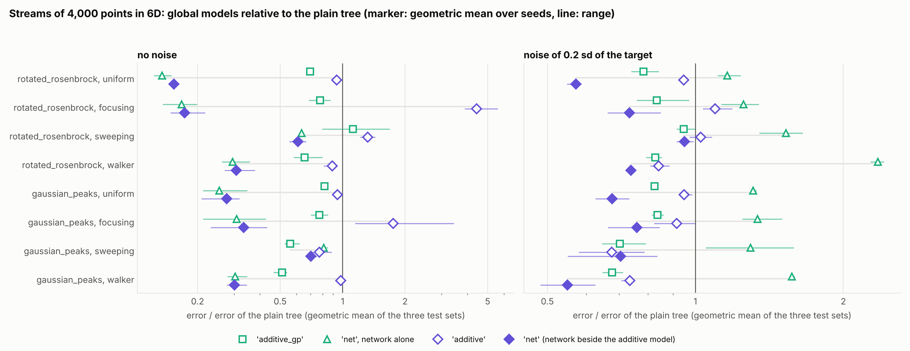
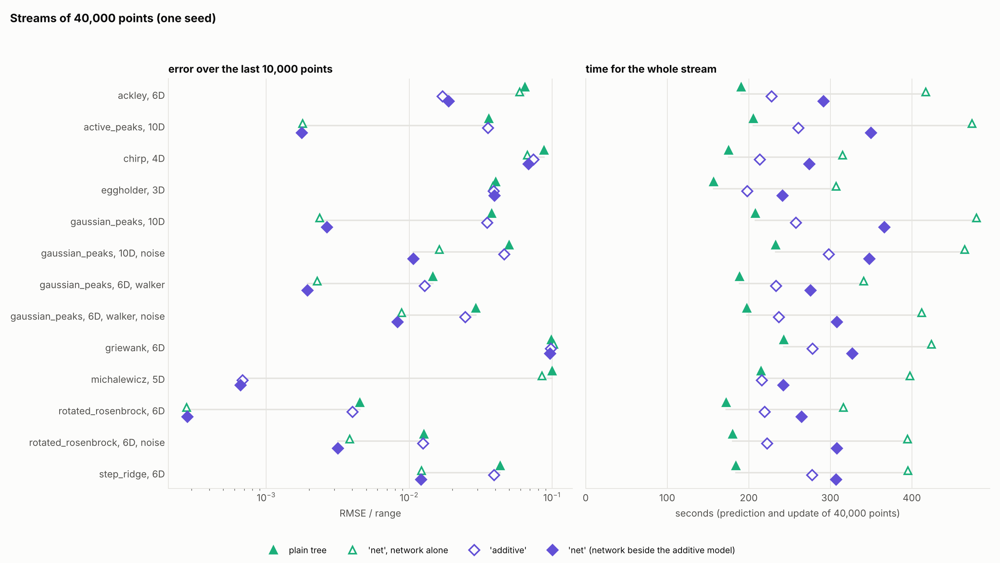

# An additive model from running sums, and the feature network beside it: design and benchmark

Question: the leaves of a tree in six to ten dimensions hold too few points to see
large-scale structure, and the two existing global models pay for it in different ways:
`'additive_gp'` with a GP fit on a subsample at several times the tree's run time, the
feature network with a model that helps on smooth coupled targets and hurts on rough or
noisy ones. Is there a global model that costs about as much as the tree itself, and a
way of running the network that does not hurt?

Short answer:

* **`global_mean='additive'`** is an additive model whose fit, hyperparameters included,
  needs the stream only through running sums. It costs 1.25 times the plain tree's
  run time. Where the target has additive structure the gain is very large (five orders
  of magnitude on the 6D Rastrigin and Levy functions at 4000 points). Where it has none
  there is no gain, and there are losses: on two fully coupled targets under four kinds
  of stream it has 1.25 of the plain tree's error without noise and 0.89
  with noise, and where a focusing stream has made the plain tree very accurate it is 30
  to 100 times worse. It is a model for targets that are known or suspected to be close
  to additive.
* **`global_mean='net'`** now runs the network beside this additive model, both judged on
  a held-out fifth of the points. On the same two coupled targets it has 0.31 of
  the plain tree's error without noise, as the network alone, and 0.70 with
  noise, where the network alone has 1.44; on targets that are sums of functions
  of one input it takes the additive model and gets its accuracy. It has a lower error than the plain tree in
  70 of 72 combinations of cell and seed without noise and 62 of 72
  with noise.
* **On ten streams of 40 000 points** (one seed) `'net'` has 0.16 of the plain tree's
  error (geometric mean) and a lower error on all ten; against the network alone it has
  0.55, within 12% wherever the network alone is ahead and far below it where the target
  has additive structure (Michalewicz: 0.0007 against 0.085 of the range). `'additive'`
  has 0.50 and is never above the plain tree there. Their run times are 1.5 and 1.2
  times the plain tree's; the network alone takes 2.0 times.
* On particle-physics-style targets (`BENCHMARK_RESULTS_particle_physics.md`) the network
  carries the gain, a factor of two on average; the additive model contributes nothing
  there.
* **What each part of `'net'` contributes** (benchmark 3). Selecting the network's weights
  on held-out points gives the protection against noise (0.52 of the error of the network
  without it on the noisy streams of benchmark 1) and costs 9% without noise at 4000
  points. The cheap leaf refit leaves the error where it was and takes 12 to 26%
  off the run time. The additive model decides targets with strong structure along single
  inputs (Rastrigin, Levy, Michalewicz, Ackley) and changes the error by 7% or less on
  average everywhere else, for 3 to 13% more run time.

`plot_additive_sums_results.py` draws the figures from the stored results.

## The additive model

### Model

For `d` inputs the model is

    f(x) ~ c + g_1(x_1) + ... + g_d(x_d),

each `g_j` a cubic polynomial plus a GP with an RBF kernel of length scale `l_j`. The GP
is written in a fixed basis: on an interval `[c_j - L_j, c_j + L_j]` that contains the
range of input `j` with a margin of half its half-width on each side, the functions
`sin(pi k (x_j - c_j + L_j) / (2 L_j)) / sqrt(L_j)`, `k = 1 ... m`, with independent
coefficients of prior variance `(a^2 / d) sqrt(2 pi) l_j exp(-(l_j w_k)^2 / 2)` at
frequency `w_k = pi k / (2 L_j)`, reproduce the RBF kernel (Solin and Särkkä, 2020) for
length scales short against the interval. The polynomials (Legendre, degree 1 to 3, with
a broad fixed prior) carry the smooth trends that sines vanishing at the ends of the
interval represent poorly. Every input gets `m = max_features // d` sines, between 16 and
128; with the default budget of 600 that is 128 sines for up to 4 inputs and 60 for 10.

### What the stream is reduced to

With `phi(x)` the row of all basis functions (`P = 1 + 3 d + d m` columns), the model is
a Bayesian linear regression, `y = phi(x)^T w + noise`, and everything it needs from the
stream is in three running sums:

    G = sum phi phi^T        b = sum phi y        c = sum phi

(and the count, mean and variance of the targets). A new point is added to the sums in
chunks of 64, at `O(P^2)` per point. From the sums:

* the coefficients are one `P x P` solve, `w = (Lambda^-1 + G / s^2)^-1 b / s^2`, at any
  time and for every point seen, not for a subsample;
* the marginal likelihood of the hyperparameters, and its gradient, are functions of `G`,
  `b` and the count alone. The hyperparameters are the `d` length scales, the amplitude
  `a` and the noise level `s`: `d + 2` numbers, whatever the budget of basis functions.

The cost of a fit therefore does not grow with the stream. The noise level absorbs
whatever in the target is not additive, so on a target without additive structure the
model fits a noise level near the target's spread and a small amplitude, and its
prediction stays close to a constant. `AdditiveGlobalMean.additive_share()` reports
`1 - s^2` in units of the target's variance.

The points themselves are kept (`d + 1` floats each) for one purpose: if the stream
leaves the interval the basis was built for, the basis is built again over the new range
and the sums are computed again from the stored points.

### Fitting

The evidence has two kinds of optimum per input, a long length scale (the input matters
through a smooth trend) and a short one (it matters through structure at a fraction of
its range), and a gradient search started in one does not find the other. The fit is
L-BFGS-B from the previous hyperparameters (from three starts the first time), then a
coordinate search: every input is tried at 0.5, 0.15, 0.04 and 0.012 of its range with
the others fixed, and a value is taken if it gains more than 3 in log evidence; after a
round with a move the gradient search runs again. One evaluation of the evidence is a
Cholesky factorisation of a `P x P` matrix.

### In the tree

1. Every observation is added to the sums and, as always, goes to its leaf.
2. At 60 observations and at every doubling of the count the hyperparameters are fitted.
3. At these moments and whenever the count has grown by a quarter, the coefficients are
   solved again and published as a new snapshot.
4. A leaf that meets a newer snapshot refits its GP on the new residual with its kernel
   hyperparameters kept (`GPRegressorInterface.refit_fixed`, one Cholesky factorisation
   of the leaf's kernel matrix); the hyperparameters are optimised on the leaf's usual
   retrain schedule. Global models whose snapshots are rare (`'additive_gp'`, the network
   alone) keep the full refit.
5. The prediction is the snapshot's value plus the leaf GP's mean.

### The variance

A leaf GP's mean at `x` is `a(x)^T r`, with `r` its training residuals. As the residuals
are `y - Phi_train w`, the tree's prediction depends on the coefficients through
`q(x) = phi(x) - Phi_train^T a(x)`, and their uncertainty contributes `q^T Cov(w) q`.
Among the leaf's points `a(x)` reproduces `phi`, `q` is small and the leaf has absorbed
the additive model's error; away from them `q` tends to `phi(x)` and the full
uncertainty of the coefficients appears. The snapshot's `leaf_variance` returns

    leaf GP variance + q^T Cov(w) q + prior variance outside the range seen

where the last term, `(a^2 / d) sum_j (1 - exp(-gap_j^2 / (2 l_j^2)))`, grows with the
distance `gap_j` of an input from the range of the points seen. It takes the place of
`error_scale`, the stream-wide error estimate that the other global models add at every
`x` alike. Per-leaf calibration (`use_calibrated_sigma`) is applied on top as before.

## The network beside the additive model

`global_mean='net'` runs a `FeatureNetLearner` and an `AdditiveGlobalMean` side by side,
both on the raw targets, and gives the leaves the residual of

    c + w_a * (additive prediction) + w_n * (network prediction).

A fifth of the points, chosen by a hash of their coordinates, is held out from both
models (`holdout=0.2`): the network does not train on them, and they do not enter the
additive model's sums. They serve three purposes.

* The network publishes the weights with the lowest error on them (`patience=None`).
  This is what protects it on noisy targets, and on some targets without noise as well
  (the oscillation probability in `BENCHMARK_RESULTS_particle_physics.md`).
* Whenever either model publishes a version, `c`, `w_a` and `w_n` are the least-squares
  fit of the held-out targets on the two models' predictions, with the two slopes kept in
  `[0, 1]`. A single model with weight one is taken when its squared error, or the fitted
  weights, are within 2% of the best combination, so that a target which one model
  explains is handed to that model alone and not to a mixture with a small, noisy share
  of the other.
* `error_scale`, which enters the leaves' sigma, is the error of the combination on the
  held-out points, less the declared noise.

The held-out points lie where the stream has been, so the weights compare the models
inside the explored region and with their present versions. The leaves take up a new
version with the cheap refit of point 4 above.

Three other ways of joining the models were measured and not kept.

* *The network on the residual of the additive part.* Worse than training it on the raw
  target for smooth coupled targets (five times the error on the 6D rotated Rosenbrock
  function at 40 000 points): the residual of an additive fit is a harder function for a
  network than the target itself.
* *Weights without the preference for a single model.* A small, noisy share of the
  network stayed on exactly additive targets (6D Rastrigin at 4000 points: an error of
  4e-5 of the range where the additive model alone has 6e-7).
* *Weights from the predictions each model made for new points before they were used*
  (a running fit with forgetting, no held-out points for the additive model). On uniform
  streams the two rules are close: over 26 runs of the particle-physics benchmark the
  held-out fit has 1.05 times the error of this one in the geometric mean, between 0.95
  and 1.08 on ten targets and 1.38 on the jet spectrum. On a random-walk stream the new
  points lie at the front of the walk, where every global model extrapolates, and the
  weights came out far too small: on the 10D likelihood of that benchmark they were 0.42
  and 0.19 where the held-out fit gives 0.03 and 0.97, and the test error was 3.9 times
  higher.

`NetGlobalMean(additive=False)`, or a tree with several outputs, gives the network alone,
with the behaviour and defaults it had before (no held-out points unless `holdout` is
set).

## Benchmark 1: streams of 4000 points

`benchmark_global_mean_streams.py`: two 6D targets that couple all inputs
(`rotated_rosenbrock`, `gaussian_peaks`) under four kinds of stream (uniform; focusing on
the minimum with a shrinking cluster; a cluster sweeping through the cube; every proposal
of a Metropolis walk), three seeds, without noise and with Gaussian noise of 0.2 standard
deviations of the target, declared to the tree. Three errors per run, each over the range
of the target: prequential (every point predicted before it is used, after a warm-up), on
a uniform test set, and on a test set drawn where the stream ended. Tree settings as in
the reference runs (`Nbar=100`, calibrated sigma). The plain tree, `'additive_gp'` and
the network alone are from earlier runs of the same benchmark with the same code paths.

Error relative to the plain tree over the 24 cells (target, stream, test set):

| | `'additive_gp'` | network alone | `'additive'` | `'net'` |
|---|---|---|---|---|
| no noise: geometric mean | **0.72** | **0.31** | **1.25** | **0.31** |
| no noise: single seeds | 0.69, 0.77, 0.70 | 0.31, 0.33, 0.29 | 1.34, 1.25, 1.18 | 0.32, 0.31, 0.31 |
| no noise: lower than the plain tree in | 66 of 72 | 68 of 72 | 35 of 72 | 70 of 72 |
| no noise: range | 0.33 to 3.37 | 0.086 to 1.34 | 0.43 to 100.37 | 0.075 to 1.10 |
| noise: geometric mean | **0.80** | **1.44** | **0.89** | **0.70** |
| noise: single seeds | 0.81, 0.81, 0.78 | 1.34, 1.49, 1.50 | 0.87, 0.92, 0.87 | 0.68, 0.71, 0.71 |
| noise: lower than the plain tree in | 64 of 72 | 8 of 72 | 57 of 72 | 62 of 72 |
| noise: range | 0.46 to 1.46 | 0.66 to 4.66 | 0.55 to 1.43 | 0.34 to 1.23 |

Per cell, on the uniform test set, geometric mean of three seeds, without noise:

| target | stream | plain tree | `'additive_gp'` | network alone | `'additive'` | `'net'` |
|---|---|---|---|---|---|---|
| rotated_rosenbrock | uniform | 0.0106 | 0.0075 | **0.0012** | 0.0100 | 0.0013 |
| rotated_rosenbrock | focusing | 0.0301 | 0.0177 | **0.0038** | 0.0481 | 0.0047 |
| rotated_rosenbrock | sweeping | 0.0647 | 0.0527 | **0.0280** | 0.0585 | 0.0290 |
| rotated_rosenbrock | walker | 0.0922 | 0.0759 | **0.0441** | 0.0942 | 0.0458 |
| gaussian_peaks | uniform | 0.0138 | 0.0112 | **0.0029** | 0.0126 | 0.0032 |
| gaussian_peaks | focusing | 0.0231 | 0.0169 | **0.0065** | 0.0285 | 0.0077 |
| gaussian_peaks | sweeping | 0.0806 | **0.0423** | 0.0572 | 0.0673 | 0.0591 |
| gaussian_peaks | walker | 0.106 | 0.0622 | 0.0320 | 0.100 | **0.0316** |

and with noise:

| target | stream | plain tree | `'additive_gp'` | network alone | `'additive'` | `'net'` |
|---|---|---|---|---|---|---|
| rotated_rosenbrock | uniform | 0.0207 | 0.0165 | 0.0238 | 0.0190 | **0.0113** |
| rotated_rosenbrock | focusing | 0.0439 | 0.0276 | 0.0485 | 0.0482 | **0.0227** |
| rotated_rosenbrock | sweeping | 0.0828 | 0.0698 | 0.0907 | 0.0675 | **0.0581** |
| rotated_rosenbrock | walker | 0.138 | 0.123 | 0.124 | 0.120 | **0.0977** |
| gaussian_peaks | uniform | 0.0262 | 0.0221 | 0.0338 | 0.0248 | **0.0169** |
| gaussian_peaks | focusing | 0.0382 | 0.0274 | 0.0502 | 0.0347 | **0.0250** |
| gaussian_peaks | sweeping | 0.112 | **0.0649** | 0.143 | 0.0734 | 0.0675 |
| gaussian_peaks | walker | 0.210 | 0.136 | 0.155 | 0.146 | **0.0838** |

On the test set where the stream ended, without noise:

| target | stream | plain tree | `'additive_gp'` | network alone | `'additive'` | `'net'` |
|---|---|---|---|---|---|---|
| rotated_rosenbrock | uniform | 0.0107 | 0.0073 | **0.0012** | 0.0099 | 0.0014 |
| rotated_rosenbrock | focusing | 3.55e-05 | 3.82e-05 | 4.44e-06 | 0.0018 | **2.94e-06** |
| rotated_rosenbrock | sweeping | 0.0052 | 0.0084 | 0.0049 | 0.0083 | **0.0045** |
| rotated_rosenbrock | walker | 0.0024 | 0.0011 | 3.09e-04 | 0.0014 | **2.92e-04** |
| gaussian_peaks | uniform | 0.0134 | 0.0112 | **0.0029** | 0.0124 | 0.0032 |
| gaussian_peaks | focusing | 1.21e-04 | 1.04e-04 | 2.55e-05 | 5.25e-04 | **2.13e-05** |
| gaussian_peaks | sweeping | 0.0115 | **0.0077** | 0.0123 | 0.0116 | 0.0103 |
| gaussian_peaks | walker | 0.0037 | 0.0013 | 8.12e-04 | 0.0028 | **7.03e-04** |

Reading:

* **`'net'`.** Without noise it is the network alone to within a few percent
  (1.02 in the geometric mean); the held-out weights give the network
  everything on these targets. With noise it has 0.49 of the network
  alone's error and is better in all 72 combinations: the network no longer fits the
  noise. Benchmark 3 separates what the held-out selection and what the additive model
  contribute to this.
* **`'additive'`.** With noise it is a modest gain. Without noise it is level with the
  plain tree on the uniform stream and mixed on the others (between 0.43 and 1.9 of the
  plain tree's error from cell to cell), with one clear failure, the focus test of the
  focusing stream: there the plain tree is at 4e-5 of the range on
  `rotated_rosenbrock`, the tree with the additive model at 2e-3. Close to its minimum
  the target is nearly a quadratic form, which is the easiest function there is for a
  small leaf; an additive fit whose basis reaches down to a thirtieth of the range leaves
  a residual with structure at the scale of those leaves. The network, whose error is
  smooth at that scale, improves the same cell by a factor of twelve.
* The rule behind both observations: a global model helps a leaf when its error is
  smoother than the target at the scale of the leaf. Nothing in the package checks this
  yet; the weights of `'net'` compare the two global models with each other, not the tree
  with and without them.

### Targets with additive structure

Uniform stream, 6D, one seed; error on the uniform test set:

Without noise:

| target | stream | plain tree | `'additive_gp'` | network alone | `'additive'` | `'net'` |
|---|---|---|---|---|---|---|
| rosenbrock | uniform | 0.0081 | **1.30e-04** | 0.0021 | 0.0025 | 0.0029 |
| rastrigin | uniform | 0.117 | 0.0639 | 0.151 | **5.11e-07** | 6.05e-07 |
| levy | uniform | 0.106 | 1.00e-04 | 0.137 | 1.09e-06 | **1.01e-06** |

With noise:

| target | stream | plain tree | `'additive_gp'` | network alone | `'additive'` | `'net'` |
|---|---|---|---|---|---|---|
| rosenbrock | uniform | 0.0245 | **0.0134** | 0.0421 | 0.0166 | 0.0144 |
| rastrigin | uniform | 0.117 | 0.0487 | 0.151 | **0.0070** | 0.0083 |
| levy | uniform | 0.106 | 0.0163 | 0.142 | **0.0080** | 0.0085 |

Rastrigin and Levy are sums of functions of one input, and the additive model learns
them to within 1e-6 of their range from 4000 points, hyperparameters included, because
every point enters its sums. Rosenbrock is a sum of functions of two adjacent inputs;
its one-input part is all this model can take, and `'additive_gp'`, whose kernel has a
pairwise term, is twenty times better there.

### Coverage and cost

One-sigma coverage on the uniform test set, without noise (0.68 is nominal), mean of
three seeds:

| target | stream | plain tree | `'additive_gp'` | network alone | `'additive'` | `'net'` |
|---|---|---|---|---|---|---|
| rotated_rosenbrock | uniform | 0.67 | 0.64 | 0.61 | 0.68 | 0.72 |
| rotated_rosenbrock | focusing | 0.33 | 0.36 | 0.07 | 0.20 | 0.19 |
| rotated_rosenbrock | sweeping | 0.39 | 0.41 | 0.52 | 0.37 | 0.61 |
| rotated_rosenbrock | walker | 0.28 | 0.25 | 0.25 | 0.29 | 0.33 |
| gaussian_peaks | uniform | 0.66 | 0.67 | 0.66 | 0.67 | 0.67 |
| gaussian_peaks | focusing | 0.54 | 0.34 | 0.14 | 0.44 | 0.35 |
| gaussian_peaks | sweeping | 0.50 | 0.42 | 0.69 | 0.46 | 0.62 |
| gaussian_peaks | walker | 0.20 | 0.16 | 0.17 | 0.29 | 0.20 |

Away from where a non-uniform stream has been, every configuration is overconfident. The
additive model and `'net'` are about as overconfident as the plain tree; the network
alone is markedly worse on the focusing stream.

Seconds for the 4000 points: plain tree 19 to 21, `'additive_gp'` 78 to 196, the network
alone 52 to 56, `'additive'` 21 to 26, `'net'` 40 to 45 (ranges over the eight cells).

## Benchmark 2: streams of 40 000 points

`compare_tree_vs_hybrid.py`: the ten reference streams of the feature network
(`BENCHMARK_RESULTS_neural_linear.md`, section 3.8), 3 to 10 inputs, one seed, and three
of them again with heteroscedastic noise (`--noise 1`). Every point is predicted before it
is used; the error is the mean over the last five batches of 2000 points of the RMSE over
the range of the batch. The plain tree and the network alone are from earlier runs with
the same code paths.

| stream | plain tree | network alone | `'additive'` | `'net'` |
|---|---|---|---|---|
| eggholder, 3D | 0.0404 | **0.0385** | 0.0390 | 0.0396 |
| rotated_rosenbrock, 6D | 0.0045 | **2.77e-04** | 0.0040 | 2.81e-04 |
| gaussian_peaks, 10D | 0.0377 | **0.0024** | 0.0352 | 0.0027 |
| gaussian_peaks, 6D, walker | 0.0146 | 0.0023 | 0.0128 | **0.0019** |
| active_peaks, 10D | 0.0361 | 0.0018 | 0.0355 | **0.0018** |
| step_ridge, 6D | 0.0434 | 0.0122 | 0.0392 | **0.0121** |
| michalewicz, 5D | 0.100 | 0.0850 | 6.84e-04 | **6.59e-04** |
| ackley, 6D | 0.0647 | 0.0595 | **0.0171** | 0.0190 |
| griewank, 6D | 0.0986 | 0.103 | 0.0980 | **0.0970** |
| chirp, 4D | 0.0875 | **0.0670** | 0.0741 | 0.0685 |
| rotated_rosenbrock, 6D, noise | 0.0127 | 0.0038 | 0.0125 | **0.0032** |
| gaussian_peaks, 6D, walker, noise | 0.0293 | 0.0088 | 0.0247 | **0.0083** |
| gaussian_peaks, 10D, noise | 0.0501 | 0.0163 | 0.0464 | **0.0107** |

Seconds for the whole stream (prediction and update of 40 000 points):

| stream | plain tree | network alone | `'additive'` | `'net'` |
|---|---|---|---|---|
| eggholder, 3D | 157 | 307 | 198 | 242 |
| rotated_rosenbrock, 6D | 172 | 316 | 220 | 265 |
| gaussian_peaks, 10D | 208 | 479 | 258 | 367 |
| gaussian_peaks, 6D, walker | 189 | 341 | 233 | 276 |
| active_peaks, 10D | 205 | 474 | 261 | 350 |
| step_ridge, 6D | 184 | 395 | 278 | 307 |
| michalewicz, 5D | 215 | 398 | 216 | 242 |
| ackley, 6D | 191 | 417 | 228 | 292 |
| griewank, 6D | 243 | 424 | 278 | 327 |
| chirp, 4D | 175 | 315 | 213 | 275 |
| rotated_rosenbrock, 6D, noise | 180 | 395 | 223 | 308 |
| gaussian_peaks, 6D, walker, noise | 198 | 412 | 237 | 308 |
| gaussian_peaks, 10D, noise | 233 | 465 | 298 | 348 |

Longest single update, seconds:

| stream | plain tree | network alone | `'additive'` | `'net'` |
|---|---|---|---|---|
| eggholder, 3D | 0.2 | 5.5 | 0.3 | 4.2 |
| rotated_rosenbrock, 6D | 0.3 | 5.4 | 0.5 | 4.2 |
| gaussian_peaks, 10D | 0.5 | 5.0 | 1.3 | 4.2 |
| gaussian_peaks, 6D, walker | 0.5 | 4.7 | 0.6 | 4.6 |
| active_peaks, 10D | 0.5 | 5.4 | 1.2 | 4.5 |
| step_ridge, 6D | 0.6 | 5.1 | 1.1 | 5.2 |
| michalewicz, 5D | 0.4 | 5.6 | 1.6 | 5.0 |
| ackley, 6D | 0.4 | 5.2 | 0.5 | 4.4 |
| griewank, 6D | 0.5 | 5.5 | 0.9 | 4.4 |
| chirp, 4D | 0.3 | 4.8 | 0.3 | 4.4 |
| rotated_rosenbrock, 6D, noise | 0.5 | 5.1 | 0.7 | 4.5 |
| gaussian_peaks, 6D, walker, noise | 0.5 | 5.1 | 0.4 | 4.7 |
| gaussian_peaks, 10D, noise | 0.6 | 5.1 | 2.7 | 4.3 |

Reading:

* **`'net'`** has a lower error than the plain tree on all ten streams without noise,
  0.16 of it in the geometric mean (the network alone 0.30, lower on nine). Where the
  network carries the target it follows the network alone, at most 12% behind (10D
  `gaussian_peaks`) and level or ahead on the walker stream, `active_peaks` and
  `step_ridge`. Where the target has additive structure it takes the additive model:
  Michalewicz is 130 times, Ackley 3 times below the network alone. Over the ten streams
  it has 0.55 of the network alone's error.
* **With noise** (three streams) `'net'` has 0.25 of the plain tree's error and 0.80 of
  the network alone's, and is the most accurate of the four on all three.
* **`'additive'`** has 0.50 of the plain tree's error. Nearly all of that is Michalewicz
  (a factor of 150) and Ackley (a factor of 4); on the other eight streams it is between
  0.85 and 0.99, and with noise between 0.85 and 0.99. These are uniform streams and one
  walker; the failure of benchmark 1 on a focusing stream does not show here.
* **Cost.** Over the ten streams `'additive'` takes 1.0 to 1.5 times the plain tree's
  run time, `'net'` 1.1 to 1.8 times, the network alone 1.8 to 2.3 times. No single
  update of the tree with the additive model takes longer than 2.7 s; with a network,
  4 to 6 s.
* The one-sigma coverage over the last 10 000 points is between 0.65 and 0.74 for every
  configuration without noise. With noise all four cover more than nominal (0.80 to
  0.99), the plain tree included: the sigma is calibrated against the noisy observations.

## Benchmark 3: the parts of `'net'` one at a time

`'net'` differs from the network alone in three ways: the network's weights are selected
on held-out points, the leaves take up a new version of the global model by the cheap
refit, and the additive model runs beside the network. Here the three are added one at a
time, on the runs of benchmarks 1 and 2 and of the particle-physics benchmark:
`hybrid` (the network alone), `hybrid_holdout`, `hybrid_cheap` and `combined` in the two
benchmark scripts of this document, `net_only`, `net_only_holdout`, `net_only_cheap` and
`net` in `benchmark_particle_physics.py`. Geometric means of the error relative to the
plain tree:

| error / error of the plain tree | network alone | + held-out selection | + cheap leaf refit | + additive model (`'net'`) |
|---|---|---|---|---|
| benchmark 1, no noise (72 runs and test sets) | 0.31 | 0.34 | 0.34 | 0.31 |
| benchmark 1, noise (72) | 1.44 | 0.75 | 0.75 | 0.70 |
| benchmark 2, Michalewicz and Ackley | 0.88 | 0.85 | 0.85 | 0.044 |
| benchmark 2, the other eight streams | 0.22 | 0.23 | 0.23 | 0.22 |
| benchmark 2, noise (3 streams) | 0.31 | 0.24 | 0.24 | 0.25 |
| particle-physics targets, 10 000 points (33 runs) | 0.54 | 0.50 | 0.50 | 0.52 |

Each step relative to the one before it, with the range over the runs:

| error / error of the column to the left | + held-out selection | + cheap leaf refit | + additive model (`'net'`) |
|---|---|---|---|
| benchmark 1, no noise (72 runs and test sets) | 1.09 (0.64 to 2.59) | 1.00 (0.93 to 1.17) | 0.93 (0.27 to 1.30) |
| benchmark 1, noise (72) | 0.52 (0.22 to 1.06) | 0.99 (0.80 to 1.16) | 0.94 (0.55 to 1.41) |
| benchmark 2, Michalewicz and Ackley | 0.96 (0.91 to 1.02) | 1.00 (1.00 to 1.00) | 0.05 (0.0076 to 0.35) |
| benchmark 2, the other eight streams | 1.01 (0.90 to 1.13) | 1.00 (0.99 to 1.02) | 0.98 (0.93 to 1.02) |
| benchmark 2, noise (3 streams) | 0.78 (0.65 to 0.94) | 1.01 (1.00 to 1.02) | 1.01 (1.00 to 1.04) |
| particle-physics targets, 10 000 points (33 runs) | 0.93 (0.13 to 1.34) | 1.01 (0.92 to 1.18) | 1.02 (0.85 to 1.61) |

The targets of benchmark 1 with additive structure (uniform stream, one seed; error on
the uniform test set over the range):

| target | noise | plain tree | network alone | + held-out selection | + cheap leaf refit | + additive model (`'net'`) |
|---|---|---|---|---|---|---|
| rosenbrock | no | 0.0081 | **0.0021** | 0.0027 | 0.0027 | 0.0029 |
| rosenbrock | yes | 0.0245 | 0.0421 | 0.0186 | 0.0185 | **0.0144** |
| rastrigin | no | 0.117 | 0.151 | 0.0971 | 0.0979 | **6.05e-07** |
| rastrigin | yes | 0.117 | 0.151 | 0.0965 | 0.0968 | **0.0083** |
| levy | no | 0.106 | 0.137 | 0.0813 | 0.0818 | **1.01e-06** |
| levy | yes | 0.106 | 0.142 | 0.0828 | 0.0825 | **0.0085** |

Seconds for six runs in which the five configurations ran side by side under the same
load. The times in the other sections come from runs made at different times, whose load
differed by up to a quarter; for comparing configurations these are the ones to use.

| run | plain tree | network alone | + held-out selection | + cheap leaf refit | + additive model (`'net'`) |
|---|---|---|---|---|---|
| benchmark 1: gaussian_peaks, uniform, 4000 points | 18 | 63 | 58 | 52 | 58 |
| benchmark 1: rotated_rosenbrock, walker, 4000 points | 22 | 58 | 55 | 49 | 52 |
| physics: relic_density, 10 000 points | 75 | 145 | 137 | 113 | 117 |
| physics: global_fit_loglike, 10 000 points | 63 | 178 | 167 | 127 | 133 |
| benchmark 2: rotated_rosenbrock, 6D, 40 000 points | 208 | 393 | 372 | 308 | 332 |
| benchmark 2: gaussian_peaks, 10D, 40 000 points | 253 | 542 | 537 | 398 | 409 |
| **relative to the plain tree** | 1 | **2.44** | **2.31** | **1.89** | **2.01** |

Reading:

* **Held-out selection** is what protects the network against noise. On the noisy streams
  of benchmark 1 the network with it has 0.52 of the error of the network without it, and
  a lower error than the plain tree in 58 of 72 cases where the network without it has
  one in 8; on the three noisy long streams it has 0.78. On the particle-physics targets
  it removes the one large failure of the network (the oscillation probability). Without
  noise it costs 9% at 4000 points and nothing at 40 000.
* **The cheap leaf refit** leaves the error where it was in all six groups (0.99 to 1.01)
  and takes 12 to 26% off the run time.
* **The additive model** decides the targets with strong structure along single inputs:
  five orders of magnitude on Rastrigin and Levy, a factor of 130 on Michalewicz and of 3
  on Ackley. On the fully coupled targets of benchmark 1 it lowers the error by 6 to 7%
  on average, with single runs between 0.27 and 1.41 of the error without it. On the
  other eight long streams, on the noisy long streams and on the particle-physics targets
  it changes the error by 2% or less on average. It adds 3 to 13% to the run time.

## Limits

* The additive model is single-output; with several outputs `'net'` runs the network
  alone.
* It has no pairwise terms. Sums for pairs of inputs would grow as the square of the
  number of basis functions per input.
* The sums give every point the same weight, whatever its declared noise.
* It can make a tree worse where the plain tree is already very accurate, or where the
  target has no additive structure and the leaves are small (benchmark 1, and the jet
  spectrum and the oscillation probability in the particle-physics benchmark).
* `'net'` weighs its two global models against each other, not against the plain tree:
  on a target where neither helps, it still subtracts the better of the two.

## Reproducing

    # benchmark 1, one cell (add --noise 0.2 for the noisy runs)
    OMP_NUM_THREADS=1 python examples/benchmark_global_mean_streams.py --target rotated_rosenbrock --streams focusing --configs tree,additive,combined,hybrid --seeds 1 --calibrate
    # benchmark 2, one configuration of one stream, then the overlay
    OMP_NUM_THREADS=1 python examples/compare_tree_vs_hybrid.py --target michalewicz --d 5 --N 40000 --config combined
    python examples/compare_tree_vs_hybrid.py --target michalewicz --d 5 --N 40000 --plot --overlay tree,hybrid,additive,combined --overlay-name additive
    # benchmark 3: the configurations hybrid_holdout and hybrid_cheap in the two commands above,
    # net_only_cheap in benchmark_particle_physics.py
    # figures
    python examples/plot_additive_sums_results.py

`results/additive_sums/` has the result lines of benchmark 1 and the times of the runs
under the same load (`timing_same_load.jsonl`), and
`results/compare_tree_vs_neural/*_additive_batches.csv` the per-batch records of
benchmark 2.
