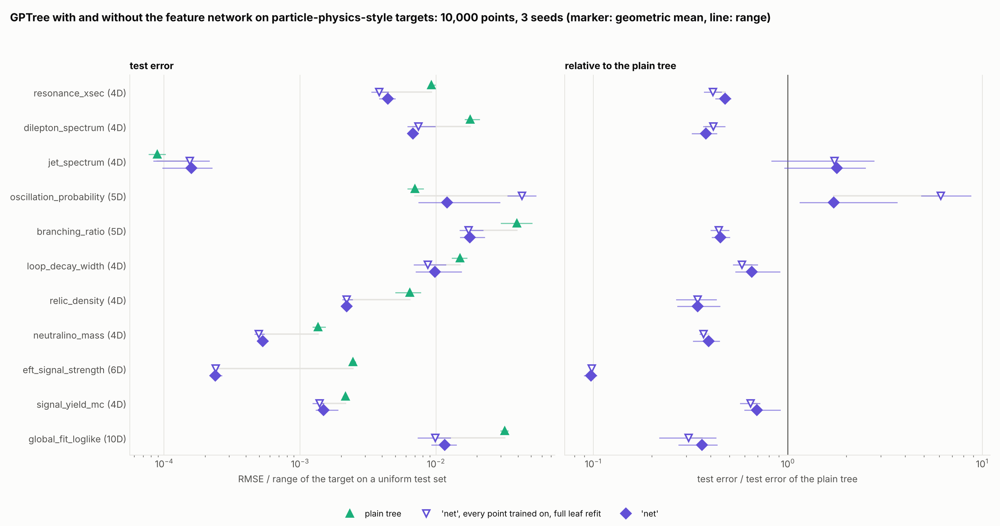
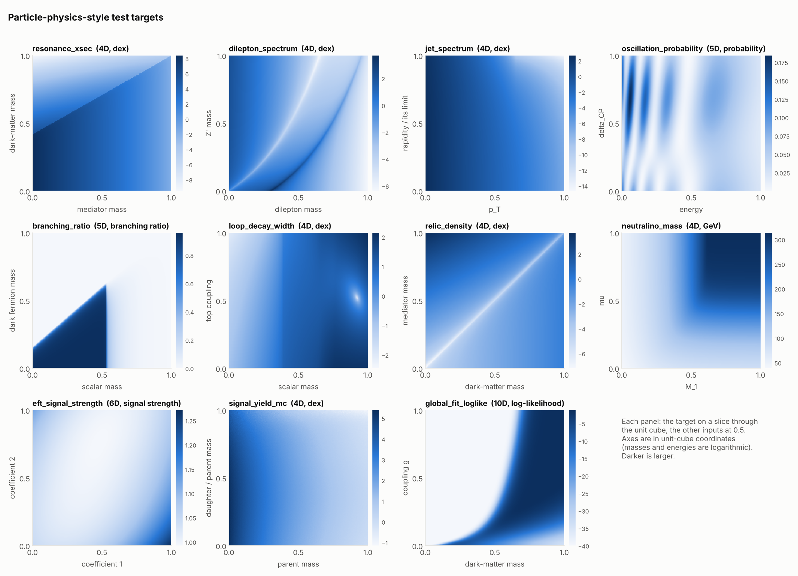
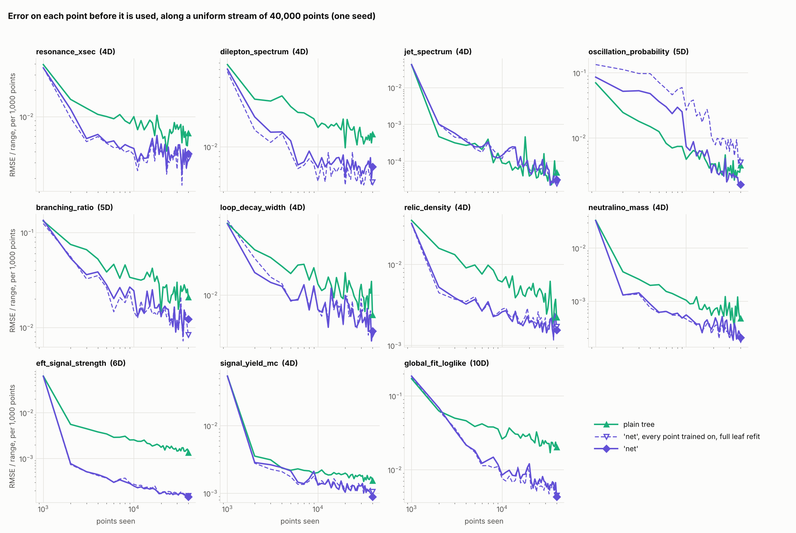

# Particle-physics-style targets: GPTree with and without the feature network

Question: on the kinds of functions that are emulated in particle physics (cross-sections
and spectra over many orders of magnitude, thresholds, resonances, oscillations, ratios,
Monte Carlo noise, likelihoods with nuisance parameters), what does the feature network
(`global_mean='net'`) add to the plain tree?

Short answer, from eleven test targets:

* **The network halves the error.** With `global_mean='net'` the tree has 0.50 of
  the plain tree's test error at 10 000 points (geometric mean over the targets and three
  seeds) and a lower error in 28 of 33 runs: a tenth on the EFT signal strength,
  0.34 to 0.48 on six targets, and about two thirds on the loop-induced width and on the
  signal yield with Monte Carlo noise.
* **Two targets gain nothing at 10 000 points.** On the oscillation probability `'net'`
  has 1.2 to 3.6 times the plain tree's error, and along the stream the plain tree is
  ahead throughout. On the jet spectrum the typical error is the same with and without
  the network (a median of 0.04% of the cross-section, a 95th percentile of 0.4 to 0.5%),
  but the RMSE, which a few test points at the kinematic edge dominate, is 1.0 to 2.5
  times the plain tree's.
* **With 40 000 points** (one seed) `'net'` has 0.48 of the plain tree's test
  error and is ahead on all eleven targets, these two included (0.73 and 0.89): on the
  oscillation probability it overtakes the plain tree after about 20 000 points.
* **Held-out selection matters without noise too.** A network trained on every point has
  6.1 times the plain tree's error on the oscillation probability at 10 000 points; with
  the held-out points of `'net'` that is 1.7, at a cost of at most 17% on the other
  targets.
* **On a sampler stream** (a Metropolis walk on the 10D likelihood, one seed) `'net'` has
  0.19 of the plain tree's error around the second half of the walk.
* The typical error is small with and without the network (a median of 0.04 to 1.2% of
  the quantity for the logarithmic targets); what the network improves is the tail at
  thresholds, dips and funnels, by factors of two to five in the 95th percentile.
* The run time of `'net'` is 1.5 to 2.0 times that of the plain tree at 10 000 points.

## The targets

`particle_physics_targets.py` has eleven functions with the structure of quantities that
are emulated in particle physics. Each is cheap (a closed form, a small quadrature or a
4 x 4 eigenproblem) and schematic: right in structure, not in normalisation. Inputs are
in the unit cube and are mapped to physical ranges, masses and energies logarithmically.

| target | inputs | quantity | what makes it hard |
|---|---|---|---|
| `resonance_xsec` | 4 | log10 of a production cross-section through a mediator that decays invisibly | sixteen orders of magnitude (between the 1st and the 99th percentile); a square-root threshold on the oblique line `M = 2 m`, below which the rate drops by three orders or more; a branching ratio that is a ratio of couplings |
| `dilepton_spectrum` | 4 | log10 of a differential cross-section with a Z' | a peak of 0.5 to 12% relative width on the diagonal `m_ll = M`, an interference dip below it, a continuum falling over nine orders |
| `jet_spectrum` | 4 | log10 of the inclusive jet cross-section in p_T and rapidity | close to a power law over most of the cube; a steep fall towards the kinematic edge at large rapidity, with a kink where that edge starts to cut the rapidity range; fourteen orders of magnitude |
| `oscillation_probability` | 5 | P(nu_mu -> nu_e) at 1300 km in matter | oscillates in `1 / E` with a phase proportional to `dm31 / E`; periodic in delta_CP; amplitudes that are products of functions of single angles |
| `branching_ratio` | 5 | invisible branching ratio of a Higgs-like scalar | between 0 and 1; unchanged when all couplings are scaled together; thresholds for WW, tt and, on a diagonal, the dark fermion |
| `loop_decay_width` | 4 | log10 of a loop-induced diphoton width | cusps where the scalar crosses a pair threshold (one on a diagonal); valleys where the loops cancel |
| `relic_density` | 4 | log10 of a dark-matter relic density | a funnel several orders of magnitude deep along `m_A = 2 m`, asymmetric from the thermal average; a threshold; a coupling that enters as a power |
| `neutralino_mass` | 4 | mass of the lightest neutralino, GeV | follows the smallest of three mass parameters, with rounded kinks where two of them cross; flat in the others |
| `eft_signal_strength` | 6 | signal strength in an effective field theory | a ratio of quadratic polynomials in six Wilson coefficients; smooth; every pair of inputs coupled |
| `signal_yield_mc` | 4 | log10 of a signal yield estimated from 10 000 simulated events per point | Monte Carlo noise that the simulation declares: below a percent where the efficiency is high, of order one where a few events pass; an efficiency that turns on along a diagonal of the mass plane |
| `global_fit_loglike` | 10 | log-likelihood of a toy global fit, saturating at -40 | three model parameters and seven nuisance parameters; Poisson terms, one-sided limits, a curved boundary of the allowed region and a plateau where a point is excluded |

For the targets without Monte Carlo noise the observation is exact and the declared sigma
is the numerical precision a user would quote: 0.1% of the quantity for the targets given
as a logarithm (4.3e-4 dex), 1e-4 for the probability and the branching ratio, 0.01 GeV,
and 1e-3 for the signal strength and the log-likelihood.

## Setup

`benchmark_particle_physics.py` streams `N` points into a tree, predicting each point
before it is used, and then predicts 3000 test points. Errors are against the noise-free
target.

* Streams: `uniform`, a random scan of the unit cube with a uniform test set; and, for the
  likelihood target, `sampler`: every proposal of a Metropolis random walk on the
  likelihood (step 0.04 per input), accepted or not, with the test set drawn around the
  second half of the walk.
* Tree settings, the same for every configuration: `Nbar=100`, `theta=1e-4`, a retrain
  every 25 points, gradual splitting, calibrated sigma, the default leaf kernel with one
  optimiser restart. The network runs with `steps_per_update=8`.
* Configurations: the plain tree; `global_mean='net'`; and, to show what the two parts
  of its training contribute, `net_full_refit` (leaves that optimise their kernel
  hyperparameters again for every new version of the network) and `net_no_holdout`
  (the same with a network trained on every point, `holdout=0`).
* 10 000 points and seeds 1 to 3 for the uniform stream, one seed for the sampler
  stream and for 40 000 points. A table entry is the geometric mean over the seeds.

## Results: uniform stream, 10 000 points

Test RMSE over the range of the target, geometric mean of three seeds:

| target | plain tree | `'net'`, every point trained on, full leaf refit | `'net'`, full leaf refit | **`'net'`** |
|---|---|---|---|---|
| resonance_xsec (4D) | 0.0093 | **0.0038** | 0.0043 | 0.0044 |
| dilepton_spectrum (4D) | 0.0179 | 0.0074 | **0.0067** | 0.0068 |
| jet_spectrum (4D) | **8.90e-05** | 1.54e-04 | 1.59e-04 | 1.59e-04 |
| oscillation_probability (5D) | **0.0070** | 0.0428 | 0.0110 | 0.0121 |
| branching_ratio (5D) | 0.0393 | **0.0174** | 0.0182 | 0.0177 |
| loop_decay_width (4D) | 0.0150 | **0.0087** | 0.0097 | 0.0098 |
| relic_density (4D) | 0.0064 | 0.0022 | 0.0022 | **0.0022** |
| neutralino_mass (4D) | 0.0014 | **4.98e-04** | 5.39e-04 | 5.30e-04 |
| eft_signal_strength (6D) | 0.0024 | 2.40e-04 | 2.45e-04 | **2.38e-04** |
| signal_yield_mc (4D) | 0.0022 | **0.0014** | 0.0015 | 0.0015 |
| global_fit_loglike (10D) | 0.0320 | **0.0099** | 0.0115 | 0.0116 |

The same relative to the plain tree, with the range over the seeds in brackets:

| target | `'net'`, every point trained on, full leaf refit | `'net'`, full leaf refit | **`'net'`** |
|---|---|---|---|
| resonance_xsec | 0.41 (0.37 to 0.45) | 0.46 (0.39 to 0.51) | 0.48 (0.43 to 0.51) |
| dilepton_spectrum | 0.41 (0.37 to 0.47) | 0.37 (0.32 to 0.42) | 0.38 (0.32 to 0.43) |
| jet_spectrum | 1.74 (0.83 to 2.76) | 1.79 (1.05 to 2.48) | 1.79 (0.96 to 2.49) |
| oscillation_probability | 6.11 (4.86 to 8.71) | 1.57 (0.97 to 3.46) | 1.72 (1.15 to 3.64) |
| branching_ratio | 0.44 (0.40 to 0.50) | 0.46 (0.42 to 0.52) | 0.45 (0.41 to 0.50) |
| loop_decay_width | 0.58 (0.53 to 0.70) | 0.65 (0.54 to 0.88) | 0.65 (0.54 to 0.91) |
| relic_density | 0.34 (0.27 to 0.43) | 0.34 (0.28 to 0.45) | 0.34 (0.27 to 0.45) |
| neutralino_mass | 0.37 (0.35 to 0.38) | 0.40 (0.34 to 0.45) | 0.39 (0.33 to 0.44) |
| eft_signal_strength | 0.10 (0.10 to 0.10) | 0.10 (0.09 to 0.11) | 0.10 (0.09 to 0.10) |
| signal_yield_mc | 0.64 (0.57 to 0.72) | 0.68 (0.59 to 0.91) | 0.69 (0.60 to 0.91) |
| global_fit_loglike | 0.31 (0.22 to 0.43) | 0.36 (0.27 to 0.42) | 0.36 (0.28 to 0.43) |
| **geometric mean** | **0.54** | **0.50** | **0.50** |
| runs with a lower error than the plain tree | 28 of 33 | 28 of 33 | 28 of 33 |

The error on each point before it is used, over the second half of the stream, relative
to the plain tree:

| target | `'net'`, every point trained on, full leaf refit | `'net'`, full leaf refit | **`'net'`** |
|---|---|---|---|
| resonance_xsec | 0.45 (0.44 to 0.45) | 0.47 (0.46 to 0.48) | 0.48 (0.47 to 0.49) |
| dilepton_spectrum | 0.39 (0.32 to 0.50) | 0.39 (0.37 to 0.40) | 0.39 (0.36 to 0.40) |
| jet_spectrum | 1.12 (0.91 to 1.50) | 1.09 (0.97 to 1.29) | 1.10 (0.96 to 1.26) |
| oscillation_probability | 8.47 (7.13 to 9.56) | 3.97 (2.82 to 6.13) | 3.94 (2.84 to 6.18) |
| branching_ratio | 0.56 (0.48 to 0.67) | 0.54 (0.46 to 0.60) | 0.53 (0.45 to 0.61) |
| loop_decay_width | 0.65 (0.56 to 0.78) | 0.69 (0.57 to 0.87) | 0.69 (0.57 to 0.88) |
| relic_density | 0.31 (0.28 to 0.35) | 0.32 (0.30 to 0.35) | 0.32 (0.31 to 0.35) |
| neutralino_mass | 0.40 (0.38 to 0.43) | 0.45 (0.40 to 0.52) | 0.45 (0.41 to 0.51) |
| eft_signal_strength | 0.11 (0.10 to 0.11) | 0.11 (0.11 to 0.12) | 0.11 (0.11 to 0.12) |
| signal_yield_mc | 0.70 (0.67 to 0.76) | 0.76 (0.62 to 0.90) | 0.78 (0.62 to 0.89) |
| global_fit_loglike | 0.40 (0.29 to 0.47) | 0.45 (0.34 to 0.57) | 0.45 (0.34 to 0.58) |
| **geometric mean** | **0.57** | **0.56** | **0.56** |
| runs with a lower error than the plain tree | 28 of 33 | 28 of 33 | 28 of 33 |

### In the unit of the target

RMSE over the range hides what an error means for the quantity. Median and 95th
percentile of the absolute test error (seed 1), for the logarithmic targets as a relative
error of the quantity itself:

| target | unit | plain tree | `'net'`, every point trained on, full leaf refit | `'net'`, full leaf refit | **`'net'`** |
|---|---|---|---|---|---|
| resonance_xsec | relative error of the quantity | 0.43% / 78% | 0.69% / 17% | 0.74% / 22% | 0.69% / 20% |
| dilepton_spectrum | relative error of the quantity | 0.72% / 136% | 0.99% / 24% | 0.98% / 30% | 1% / 29% |
| jet_spectrum | relative error of the quantity | 0.039% / 0.46% | 0.042% / 0.34% | 0.043% / 0.37% | 0.045% / 0.4% |
| oscillation_probability | probability | 0.00014 / 0.0026 | 0.0003 / 0.0097 | 0.00013 / 0.0028 | 0.00013 / 0.0027 |
| branching_ratio | branching ratio | 0.00021 / 0.039 | 0.00058 / 0.015 | 0.00081 / 0.02 | 0.00089 / 0.022 |
| loop_decay_width | relative error of the quantity | 0.61% / 25% | 0.76% / 13% | 0.73% / 13% | 0.74% / 14% |
| relic_density | relative error of the quantity | 0.099% / 32% | 0.23% / 9.4% | 0.16% / 8.5% | 0.18% / 9% |
| neutralino_mass | GeV | 0.059 / 1.4 | 0.039 / 0.53 | 0.038 / 0.51 | 0.037 / 0.51 |
| eft_signal_strength | signal strength | 0.0028 / 0.016 | 0.00038 / 0.0014 | 0.00035 / 0.0014 | 0.00034 / 0.0013 |
| signal_yield_mc | relative error of the quantity | 1.2% / 7.3% | 0.72% / 3.9% | 0.69% / 3.6% | 0.68% / 3.8% |
| global_fit_loglike | log-likelihood | 0.12 / 2.8 | 0.046 / 0.45 | 0.052 / 0.58 | 0.058 / 0.57 |

The typical error is small everywhere, and the tails are where the thresholds, dips and
funnels are: a point next to a cliff of three orders of magnitude is wrong by a large
factor if the cliff is misplaced by a fraction of the spacing of the data. The network
shortens these tails by factors of two to five (twelve on the EFT signal strength). It
lowers the median error as well on four targets (neutralino mass, EFT signal strength,
signal yield, likelihood), leaves it where it was on the jet spectrum and the oscillation
probability, and raises it on the five targets with the sharpest thresholds, by 20% on
the loop-induced width and by up to a factor of four on the branching ratio.

### The two parts of the network's training

`'net'` keeps a fifth of the points out of the network's training and publishes the
weights with the lowest loss on them, and its leaves take up a new version of the
network by a refit with their kernel hyperparameters kept. Relative to the network
trained on every point (`net_no_holdout`), held-out selection has 0.93 of the
error in the geometric mean. That average hides one large gain and several small losses:
on the oscillation probability the network trained on every point has 6.1 times the
plain tree's error and with held-out selection 1.6 to 1.7 times, and on the other ten
targets the error is between 0.90 and 1.17 of what it was. The cheap leaf refit changes
the error by 1% in the geometric mean (0.92 to 1.18 over the 33 runs).

### Uncertainty

Fraction of the test points whose error is within the predicted sigma (0.68 is nominal),
mean of three seeds:

| target | plain tree | `'net'`, every point trained on, full leaf refit | `'net'`, full leaf refit | **`'net'`** |
|---|---|---|---|---|
| resonance_xsec (4D) | 0.66 | 0.78 | 0.77 | 0.76 |
| dilepton_spectrum (4D) | 0.67 | 0.68 | 0.70 | 0.70 |
| jet_spectrum (4D) | 0.69 | 0.66 | 0.60 | 0.59 |
| oscillation_probability (5D) | 0.66 | 0.69 | 0.59 | 0.57 |
| branching_ratio (5D) | 0.76 | 0.64 | 0.72 | 0.71 |
| loop_decay_width (4D) | 0.67 | 0.64 | 0.67 | 0.67 |
| relic_density (4D) | 0.64 | 0.71 | 0.69 | 0.68 |
| neutralino_mass (4D) | 0.67 | 0.72 | 0.70 | 0.70 |
| eft_signal_strength (6D) | 0.67 | 0.42 | 0.38 | 0.45 |
| signal_yield_mc (4D) | 0.97 | 0.85 | 0.87 | 0.87 |
| global_fit_loglike (10D) | 0.70 | 0.63 | 0.65 | 0.64 |

Two rows stand out. On the EFT signal strength the trees with the network cover only
0.38 to 0.45 on the test set: the error left after a very accurate network is small and
structured, and the leaves' sigma underestimates it. On the signal yield with Monte Carlo
noise every configuration covers more than nominal, the plain tree included (0.97): the
sigma is calibrated against the noisy observations and is scored here against the
noise-free yield.

### Cost

Seconds for the 10 000 points of two targets (prediction and update of every point), with
the four configurations running side by side under the same load:

| target | plain tree | `'net'`, every point trained on, full leaf refit | `'net'`, full leaf refit | **`'net'`** |
|---|---|---|---|---|
| relic_density | 75 | 145 | 137 | 113 |
| global_fit_loglike | 63 | 178 | 167 | 127 |

`'net'` takes 1.5 to 2.0 times the plain tree's run time on these two targets; with the
full leaf refit it would take 1.8 to 2.7 times.

## Results: a sampler stream

The 10D likelihood, 10 000 proposals of a Metropolis walk, test points around the second
half of the walk (one seed):

| | plain tree | `'net'`, every point trained on, full leaf refit | `'net'`, full leaf refit | **`'net'`** |
|---|---|---|---|---|
| test RMSE / range | 0.0211 | 0.0042 | 0.0037 | 0.0040 |
| relative to the plain tree | 1.00 | 0.20 | 0.18 | 0.19 |
| prequential RMSE / range, second half | 0.0617 | 0.0620 | 0.0422 | 0.0422 |
| coverage on the test points | 0.71 | 0.65 | 0.59 | 0.58 |

In the region the walk has explored the network lowers the error by a factor of five. On
the points at the front of the walk (the prequential row) the network extrapolates;
there `'net'` has 0.68 of the plain tree's error and the network trained on every point
is level with it.

## Results: 40 000 points

One seed, uniform stream. Test RMSE over the range of the target:

| target | plain tree | `'net'`, every point trained on, full leaf refit | `'net'`, full leaf refit | **`'net'`** |
|---|---|---|---|---|
| resonance_xsec (4D) | 0.0057 | **0.0039** | 0.0043 | 0.0040 |
| dilepton_spectrum (4D) | 0.0127 | **0.0045** | 0.0055 | 0.0057 |
| jet_spectrum (4D) | 5.05e-05 | 4.28e-05 | **4.26e-05** | 4.50e-05 |
| oscillation_probability (5D) | 0.0025 | 0.0036 | 0.0020 | **0.0018** |
| branching_ratio (5D) | 0.0208 | 0.0119 | 0.0121 | **0.0114** |
| loop_decay_width (4D) | 0.0085 | 0.0065 | 0.0059 | **0.0058** |
| relic_density (4D) | 0.0035 | 0.0021 | **0.0020** | 0.0020 |
| neutralino_mass (4D) | 7.14e-04 | **2.42e-04** | 2.89e-04 | 2.94e-04 |
| eft_signal_strength (6D) | 0.0015 | **1.61e-04** | 1.64e-04 | 1.65e-04 |
| signal_yield_mc (4D) | 0.0017 | 0.0012 | **0.0011** | 0.0012 |
| global_fit_loglike (10D) | 0.0219 | **0.0048** | 0.0055 | 0.0053 |

Relative to the plain tree:

| target | `'net'`, every point trained on, full leaf refit | `'net'`, full leaf refit | **`'net'`** |
|---|---|---|---|
| resonance_xsec | 0.69 | 0.75 | 0.70 |
| dilepton_spectrum | 0.35 | 0.43 | 0.45 |
| jet_spectrum | 0.85 | 0.84 | 0.89 |
| oscillation_probability | 1.44 | 0.78 | 0.73 |
| branching_ratio | 0.57 | 0.58 | 0.55 |
| loop_decay_width | 0.76 | 0.69 | 0.68 |
| relic_density | 0.60 | 0.56 | 0.56 |
| neutralino_mass | 0.34 | 0.40 | 0.41 |
| eft_signal_strength | 0.11 | 0.11 | 0.11 |
| signal_yield_mc | 0.67 | 0.64 | 0.66 |
| global_fit_loglike | 0.22 | 0.25 | 0.24 |
| **geometric mean** | **0.49** | **0.48** | **0.48** |
| runs with a lower error than the plain tree | 10 of 11 | 11 of 11 | 11 of 11 |

The curves are the error on each batch of 1000 points before the points are used.

* **The gain holds at four times the data.** `'net'` has 0.48 of the plain tree's test
  error and is ahead on all eleven targets; for the same seed at 10 000 points the figure
  was also 0.48. Along the stream its error over the eleven targets is 0.61 of the plain
  tree's on the first 5000 points, 0.53 up to 10 000, 0.50 up to 20 000 and 0.48 after
  that.
* **The gain moves between targets.** It shrinks on three, where the tree with the
  network improves little between 10 000 and 40 000 points while the plain tree keeps
  improving (resonance cross-section 0.43 to 0.70, relic density 0.33 to 0.56,
  loop-induced width 0.54 to 0.68). It stays within 0.06 on six, and it appears on the
  two targets that had none.
* **Oscillation probability.** `'net'` has 2.4 to 3.1 times the plain tree's error over
  the first 10 000 points, 1.1 times between 10 000 and 20 000, and 0.76 of it over the
  last 10 000 (0.73 on the test set). The network trained on every point is at twice the
  plain tree's error to the end.
* **Jet spectrum.** With the network the tree is behind the plain tree by a factor of 1.1
  to 1.6 along the first 30 000 points and level with it on the last 10 000. On the test
  set `'net'` has 0.89 of the plain tree's RMSE: the median error is 0.02 to 0.03% of the
  cross-section with and without the network, and the largest error, at the kinematic
  edge, is now smaller with it (0.013 dex) than without (0.027 dex).
* **Held-out selection and the cheap leaf refit** change the error by 2% and 1% in the
  geometric mean. Target by target, held-out selection has between 0.54 (oscillation
  probability) and 1.23 (dilepton spectrum) of the error of the network trained on every
  point.
* **Uncertainty.** The one-sigma coverage of `'net'` on the test set is between 0.62 and
  0.77, except on the signal yield with Monte Carlo noise (1.00, for the reason given
  above). On the EFT signal strength it is 0.63, where it was 0.45 at 10 000 points.

## Where the network is slow to help

**Jet spectrum.** Close to a power law in the bulk, where the plain tree's median error
is 0.04% of the cross-section and its 95th percentile 0.4 to 0.5%. With the network both
are the same within a fifth. The RMSE is set elsewhere: at the largest rapidities, near
the transverse momentum above which the kinematic limit cuts the rapidity range, the
spectrum falls by orders of magnitude within a short distance. At 10 000 points the
largest test error of the trees with the network is 0.05 to 0.12 dex there, against 0.02
to 0.03 dex for the plain tree; the factor in the RMSE comes from these few points.
With 40 000 points the trees with the network no longer lose in that corner, and `'net'`
has 0.89 of the plain tree's RMSE.

**Oscillation probability.** The phase of the oscillation is `dm31 / E`, so the target
is a wave whose wavelength changes across the cube. The network fits the wave
incompletely, and the error it leaves is again a wave, no easier for a leaf than the
target. Along the first 10 000 points the plain tree is ahead: over the second half of
the stream `'net'` has 2.8 to 6.2 times its error on the points before they are used
(three seeds), and at the end 1.2 to 3.6 times on the test set. The network trained on
every point is at 4.9 to 8.7 times.
With 40 000 points the order changes: `'net'` is close to the plain tree between 10 000
and 20 000 points and has 0.76 of its error over the last 10 000.

Nothing in the package detects these cases. A trial is the practical test, since the
prequential error needs no test set: stream the points into a plain tree and into one
with `global_mean='net'`, and compare the errors on the points before they were used. The
order can change along the stream, as on the oscillation probability, so a trial of a few
thousand points settles the question only for streams of about that length.

## Reproducing

    # one cell (a few minutes; add --N 40000 for the long streams); results as a line starting with RESULT
    OMP_NUM_THREADS=1 python examples/benchmark_particle_physics.py --targets relic_density --configs tree,net_no_holdout,net_full_refit,net --seeds 1
    # the sampler stream
    OMP_NUM_THREADS=1 python examples/benchmark_particle_physics.py --targets global_fit_loglike --stream sampler --configs tree,net
    # tables and figures from the stored lines
    python examples/benchmark_particle_physics.py --summarize examples/results/particle_physics/uniform_N10000_seed*.jsonl
    python examples/plot_particle_physics.py

`results/particle_physics/` has the result lines of every run and the times of the runs
under the same load (`timing_same_load.jsonl`).
