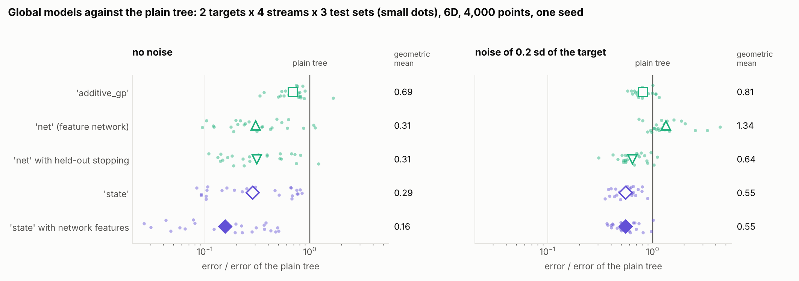
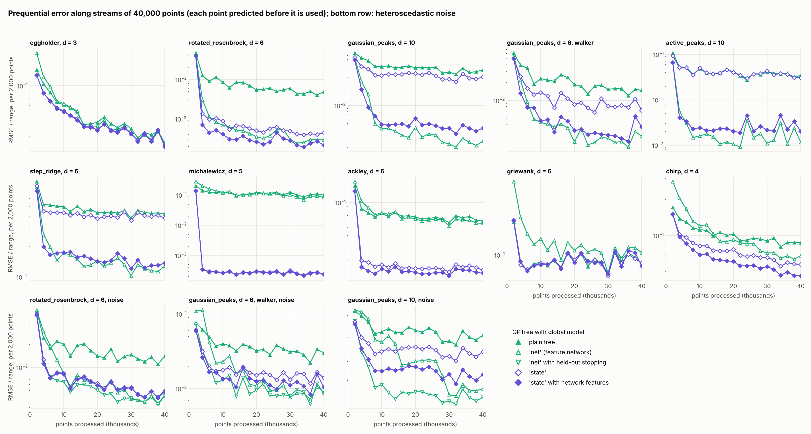

# Interaction-order state as global model: design and benchmark

Question: can one global model serve targets of different structure (additive, pairwise,
fully coupled) without being told which one it faces, on streams that do not sample
uniformly and on noisy data, and can it give the tree an uncertainty that knows where the
global model has data?

Short answer: yes on streams of a few thousand points, at six to eight times the run
time of the plain tree. Long streams add two qualifications (last point): on targets of
many inputs it needs its network features, and on smooth coupled targets the feature
network alone ends ahead of it.

* On two targets that couple all inputs, under four kinds of stream and for three seeds,
  the tree with the state has 0.29 of the plain tree's error without noise and 0.57 with
  noise (geometric mean over 24 cells; 0.28 to 0.30 and 0.55 to 0.60 for the single
  seeds), and a lower error than the plain tree in 142 of the 144 combinations of cell and
  seed. With network features it has 0.15 and 0.56. `global_mean='net'` has 0.31 and 1.44.
* On three targets with additive or pairwise structure (one seed) it is two to four orders
  of magnitude below the plain tree without noise and 3 to 16 times below with noise, and
  below `'additive_gp'` in all six cases.
* Away from the stream its one-sigma coverage is 0.50 to 0.56 without noise, where the
  other modes have 0.31 to 0.37.
* A by-product, usable on its own: held-out stopping for the feature network
  (`holdout`), which takes `'net'` from 1.44 to 0.66 of the plain tree's error with noise.
* On ten streams of 40 000 points with 3 to 10 inputs (one seed) the state with network
  features is better than the plain tree on all ten and better than `'net'` on six, by
  factors of up to 350; on the other four it has 1.1 to 1.7 times the error of `'net'`.
  The state without network features is not enough on targets of ten inputs that have no
  additive structure. See "Long streams" below.

The first four points are from streams of 4000 points.



`results/state_mean/` also has `streams.png` (every cell), `coverage.png` and
`additive.png`; `plot_state_mean_results.py` draws them from the result lines.

## The model

### One prior for every order of interaction

For `d` inputs, with `k_j(x, x') = exp(-(x_j - x'_j)^2 / (2 l_j^2))`:

    k(x, x') = s1^2 / d * e_1  +  s2^2 / C(d,2) * e_2  +  sf^2 * prod_j k_j  (+ sig^2 for the noise)

`e_1 = sum_j k_j` and `e_2 = sum_{i<j} k_i k_j` are the first two elementary symmetric
polynomials of the `k_j` (the additive kernels of Duvenaud, Nickisch and Rasmussen, 2011).
A function drawn from the first term is a sum of functions of one input each, from the
second a sum of functions of two inputs, from the last a function in which all inputs
interact. The hyperparameters are the `d` length scales, shared by the three terms, the
weights `s1`, `s2`, `sf` and the noise level `sig`: `d + 4` numbers. They maximise the exact
marginal likelihood (closed-form gradient, L-BFGS-B, at most 60 evaluations per start) on a
coverage reservoir of at most 1000 points, with the targets standardised.
`StateGlobalMean.order_shares()` reports `s1^2 : s2^2 : sf^2` as fractions. `max_order=1`
drops the pairwise term; with two inputs it is dropped because it equals the last term.

### From the prior to a linear model

A GP with this prior fitted to all `N` points would cost `O(N^3)`. The state is a linear
model `f(x) = phi(x)^T w + e(x)` that keeps as much of the prior as a fixed number of
features can, and whose cost per solve is linear in `N`:

* **Additive term, sine basis.** On an interval `[c_j - L_j, c_j + L_j]` that contains the
  range of input `j` with a margin, the functions `sin(pi m (x_j - c_j + L_j) / (2 L_j)) /
  sqrt(L_j)`, `m = 1, 2, ...`, with independent coefficients of prior variance
  `s1^2 / d * sqrt(2 pi) l_j exp(-(l_j w_m)^2 / 2)` at frequency `w_m = pi m / (2 L_j)`,
  reproduce the RBF kernel in input `j` (Solin and Särkkä, 2020). Frequencies up to
  `7.5 / l_j` are kept, between 8 and 128 per input, and the interval follows the range
  explored so far. No point of the stream is singled out: the additive part of the target
  is learned from every point at a cost that depends on the number of basis functions only.
* **Higher terms, kernel centres.** For `k_rest = s2^2 / C(d,2) * e_2 + sf^2 * prod_j k_j`
  the features are `psi(x) = W^T k_rest(U, x)` with `U` the points of a second coverage
  reservoir (500) and `W` the whitening of `k_rest(U, U)`, so that `psi(x)^T psi(x')` is the
  Nyström approximation of `k_rest`.
* **Remainder, the leaves as blocks.** What the centres do not carry, `e(x)`, has the
  covariance `k_rest(x, x') - psi(x)^T psi(x')`. It is kept among the points that one leaf
  owns and dropped between leaves (the partially independent conditional approximation of
  Snelson and Ghahramani, 2007, with the tree's partition as its blocks). For a leaf with
  points `X_c`: `R_c = k_rest(X_c, X_c) - Psi_c Psi_c^T + diag(noise)`, the noise of a point
  being the larger of its declared variance and the fitted `sig^2`.
* **Solve.** With `Lambda` the prior variances of the coefficients,
  `M = Lambda^-1 + sum_c Phi_c^T R_c^-1 Phi_c` and `w = M^-1 sum_c Phi_c^T R_c^-1 t_c`: one
  pass over the leaves, `O(n_c^3 + n_c P^2)` per leaf with `P` features, and one `P x P`
  factorisation.
* **Network features (`net=True`).** A `FeatureNetLearner` (3 x 128 SiLU, the network of
  `global_mean='net'`) is refitted with held-out stopping (`holdout=0.2`) on the residual of
  the additive part alone, whenever the prior is due. Its last hidden layer, standardised,
  is appended to `phi`. The prior variance of these coefficients is the one of nine values
  between 1e-6 and 1e-1 with the highest evidence on the held-out points: features of a
  network that has only memorised its training points get a narrow prior and drop out.

### In the tree

1. Every observation goes to the two coverage reservoirs and, as always, to its leaf.
2. At 60 observations and at every doubling of the count the prior is due. Once the
   reservoir is full the fit starts from the previous hyperparameters only, and is skipped
   if less than a quarter of the reservoir has been replaced since the last one.
3. At these moments and whenever the count has grown by a quarter, the coefficients are
   solved again from the points in the leaves and published as a new snapshot.
4. A leaf that meets a newer snapshot refits its GP on the new residual with its
   hyperparameters kept (`GPRegressorInterface.refit_fixed`); the hyperparameters are
   optimised on the leaf's usual retrain schedule. Global models with rare snapshots
   (`'additive_gp'`, `'net'`) keep the full refit.
5. The prediction is `phi(x)^T w` plus the leaf GP's mean.

### The variance

A leaf GP's mean at `x` is `a(x)^T r`, with `r` its training residuals. As these residuals
are `y - Phi_train w`, the tree's prediction depends on the coefficients through
`q(x) = phi(x) - Phi_train^T a(x)`, and their uncertainty contributes `q^T M^-1 q`. Among
the leaf's points `a(x)` reproduces `phi`, `q` is small, and the leaf has absorbed the
state's error; away from them `q` tends to `phi(x)` and the full uncertainty of the
coefficients appears. The snapshot's `leaf_variance` returns

    max(leaf GP variance, remainder variance) + q^T M^-1 q

where the remainder variance is the prior variance of `e(x)` given the leaf's training
points. It takes the place of `error_scale`, the stream-wide error estimate that the other
global models add at every `x` alike. Per-leaf calibration (`use_calibrated_sigma`) is
applied on top as before.

## Benchmark

Setup (`examples/benchmark_global_mean_streams.py`):

* Targets `RotatedRosenbrock` and `GaussianPeaks` in 6 dimensions (every input coupled
  through a fixed rotation) under the four streams of
  `BENCHMARK_RESULTS_global_mean_streams.md` (uniform, focusing, sweeping, walker), 4000
  points, seeds 1 to 3; the seed sets the stream, the noise, the tree's routing and the
  optimiser restarts. Also `Rosenbrock`, `Rastrigin` and `Levy` in 6 dimensions (sums of
  terms in one or two coordinates) on the uniform stream, seed 1.
* Without noise (the benchmark's nominal sigma of `1e-3 |y|`) and with Gaussian noise of
  0.2 standard deviations of the target (`--noise 0.2`), declared to the tree.
* Tree: `GPTree(Default_GPR(n_restarts_optimizer=1), Nbar=100, theta=1e-4,
  retrain_every_n_points=25, splitting_strategy='gradual', use_calibrated_sigma=True)`.
* Configurations: `tree`; `additive_gp` (`global_pkg`); `net` (`hybrid`); `net` with
  `holdout=0.2` (`hybrid_holdout`); `state`; `state` with `net=True` (`state_net`).
* Metrics as in the stream benchmark, all against the noise-free target: NRMSE = RMSE /
  range of the target; `prequential` on the stream after the first 666 points, `uniform
  test` on 3000 uniform points, `focus test` on 3000 points where the stream ended.
  Coverage is the fraction of errors within one predicted sigma (0.68 for a calibrated
  Gaussian). A cell of a table is the geometric mean over the seeds (the mean for
  coverage and time).

### Without noise

| | error relative to the tree: geometric mean (range over the seeds) | cells and seeds with lower error than the tree | than `net` | largest ratio to the tree in one run |
|---|---|---|---|---|
| tree | 1 |  | 4 of 72 |  |
| `additive_gp` | 0.72 (0.69 to 0.77) | 66 of 72 | 10 of 72 | 3.37 |
| `net` | 0.31 (0.29 to 0.33) | 68 of 72 |  | 1.34 |
| `net`, held-out stopping | 0.32 (0.31 to 0.33) | 70 of 72 | 25 of 72 | 1.21 |
| `state` | 0.29 (0.28 to 0.30) | 72 of 72 | 43 of 72 | 0.86 |
| `state`, `net=True` | 0.15 (0.14 to 0.17) | 72 of 72 | 61 of 72 | 0.78 |

Prequential NRMSE (bold: lowest of the row)

| target | stream | tree | `additive_gp` | `net` | `net`, held-out stopping | `state` | `state`, `net=True` |
|---|---|---|---|---|---|---|---|
| rotated_rosenbrock | uniform | 0.0152 | 0.0106 | 0.0029 | 0.0035 | 0.0016 | **8.61e-04** |
| rotated_rosenbrock | focusing | 0.0069 | 0.0051 | 0.0020 | 0.0029 | 7.43e-04 | **5.33e-04** |
| rotated_rosenbrock | sweeping | 0.0060 | 0.0064 | 0.0037 | 0.0044 | 0.0013 | **9.62e-04** |
| rotated_rosenbrock | walker | 0.0062 | 0.0049 | 0.0026 | 0.0031 | 0.0016 | **0.0011** |
| gaussian_peaks | uniform | 0.0168 | 0.0135 | 0.0061 | 0.0074 | 0.0128 | **0.0057** |
| gaussian_peaks | focusing | 0.0073 | 0.0054 | 0.0037 | 0.0045 | 0.0049 | **0.0034** |
| gaussian_peaks | sweeping | 0.0260 | 0.0129 | 0.0183 | 0.0171 | **0.0112** | 0.0125 |
| gaussian_peaks | walker | 0.0111 | 0.0071 | **0.0047** | 0.0053 | 0.0077 | 0.0056 |

Uniform-test NRMSE

| target | stream | tree | `additive_gp` | `net` | `net`, held-out stopping | `state` | `state`, `net=True` |
|---|---|---|---|---|---|---|---|
| rotated_rosenbrock | uniform | 0.0106 | 0.0075 | 0.0012 | 0.0015 | 0.0012 | **5.16e-04** |
| rotated_rosenbrock | focusing | 0.0301 | 0.0177 | 0.0038 | 0.0046 | 0.0034 | **0.0023** |
| rotated_rosenbrock | sweeping | 0.0647 | 0.0527 | 0.0280 | 0.0275 | **0.0104** | 0.0130 |
| rotated_rosenbrock | walker | 0.0922 | 0.0759 | 0.0441 | 0.0456 | **0.0268** | 0.0278 |
| gaussian_peaks | uniform | 0.0138 | 0.0112 | 0.0029 | **0.0023** | 0.0109 | 0.0024 |
| gaussian_peaks | focusing | 0.0231 | 0.0169 | **0.0065** | 0.0086 | 0.0177 | 0.0080 |
| gaussian_peaks | sweeping | 0.0806 | 0.0423 | 0.0572 | 0.0514 | 0.0462 | **0.0317** |
| gaussian_peaks | walker | 0.1063 | 0.0622 | 0.0320 | 0.0316 | 0.0811 | **0.0291** |

Focus-test NRMSE

| target | stream | tree | `additive_gp` | `net` | `net`, held-out stopping | `state` | `state`, `net=True` |
|---|---|---|---|---|---|---|---|
| rotated_rosenbrock | uniform | 0.0107 | 0.0073 | 0.0012 | 0.0015 | 0.0012 | **5.19e-04** |
| rotated_rosenbrock | focusing | 3.55e-05 | 3.82e-05 | 4.44e-06 | 6.38e-06 | 3.25e-06 | **1.21e-06** |
| rotated_rosenbrock | sweeping | 0.0052 | 0.0084 | 0.0049 | 0.0030 | 7.47e-04 | **4.08e-04** |
| rotated_rosenbrock | walker | 0.0024 | 0.0011 | 3.09e-04 | 2.83e-04 | 1.65e-04 | **6.79e-05** |
| gaussian_peaks | uniform | 0.0134 | 0.0112 | 0.0029 | **0.0023** | 0.0107 | 0.0023 |
| gaussian_peaks | focusing | 1.21e-04 | 1.04e-04 | 2.55e-05 | 1.86e-05 | 5.74e-05 | **1.73e-05** |
| gaussian_peaks | sweeping | 0.0115 | 0.0077 | 0.0123 | 0.0081 | 0.0067 | **0.0046** |
| gaussian_peaks | walker | 0.0037 | 0.0013 | 8.12e-04 | 9.93e-04 | 0.0012 | **5.41e-04** |

### With noise of 0.2 sd

| | error relative to the tree: geometric mean (range over the seeds) | cells and seeds with lower error than the tree | than `net` | largest ratio to the tree in one run |
|---|---|---|---|---|
| tree | 1 |  | 64 of 72 |  |
| `additive_gp` | 0.80 (0.78 to 0.81) | 64 of 72 | 67 of 72 | 1.46 |
| `net` | 1.44 (1.34 to 1.50) | 8 of 72 |  | 4.66 |
| `net`, held-out stopping | 0.66 (0.64 to 0.68) | 66 of 72 | 72 of 72 | 1.29 |
| `state` | 0.57 (0.55 to 0.60) | 70 of 72 | 71 of 72 | 1.21 |
| `state`, `net=True` | 0.56 (0.55 to 0.57) | 69 of 72 | 72 of 72 | 1.07 |

Prequential NRMSE

| target | stream | tree | `additive_gp` | `net` | `net`, held-out stopping | `state` | `state`, `net=True` |
|---|---|---|---|---|---|---|---|
| rotated_rosenbrock | uniform | 0.0249 | 0.0187 | 0.0283 | 0.0135 | **0.0103** | 0.0105 |
| rotated_rosenbrock | focusing | 0.0135 | 0.0111 | 0.0196 | 0.0099 | **0.0080** | 0.0080 |
| rotated_rosenbrock | sweeping | 0.0151 | 0.0158 | 0.0327 | 0.0150 | 0.0120 | **0.0112** |
| rotated_rosenbrock | walker | 0.0147 | 0.0118 | 0.0670 | 0.0142 | **0.0105** | 0.0114 |
| gaussian_peaks | uniform | 0.0292 | 0.0236 | 0.0400 | 0.0212 | 0.0192 | **0.0175** |
| gaussian_peaks | focusing | 0.0159 | 0.0130 | 0.0240 | 0.0123 | 0.0105 | **0.0103** |
| gaussian_peaks | sweeping | 0.0385 | 0.0263 | 0.0554 | 0.0270 | **0.0231** | 0.0233 |
| gaussian_peaks | walker | 0.0296 | 0.0212 | 0.0728 | 0.0241 | **0.0160** | 0.0171 |

Uniform-test NRMSE

| target | stream | tree | `additive_gp` | `net` | `net`, held-out stopping | `state` | `state`, `net=True` |
|---|---|---|---|---|---|---|---|
| rotated_rosenbrock | uniform | 0.0207 | 0.0165 | 0.0238 | 0.0091 | **0.0075** | 0.0080 |
| rotated_rosenbrock | focusing | 0.0439 | 0.0276 | 0.0485 | 0.0225 | **0.0176** | 0.0202 |
| rotated_rosenbrock | sweeping | 0.0828 | 0.0698 | 0.0907 | 0.0463 | **0.0399** | 0.0427 |
| rotated_rosenbrock | walker | 0.1380 | 0.1231 | 0.1237 | **0.0775** | 0.1061 | 0.0884 |
| gaussian_peaks | uniform | 0.0262 | 0.0221 | 0.0338 | 0.0138 | 0.0167 | **0.0129** |
| gaussian_peaks | focusing | 0.0382 | 0.0274 | 0.0502 | 0.0265 | 0.0244 | **0.0231** |
| gaussian_peaks | sweeping | 0.1120 | 0.0649 | 0.1431 | 0.0573 | **0.0498** | 0.0514 |
| gaussian_peaks | walker | 0.2101 | 0.1363 | 0.1550 | **0.0741** | 0.1164 | 0.0833 |

Focus-test NRMSE

| target | stream | tree | `additive_gp` | `net` | `net`, held-out stopping | `state` | `state`, `net=True` |
|---|---|---|---|---|---|---|---|
| rotated_rosenbrock | uniform | 0.0205 | 0.0165 | 0.0247 | 0.0095 | **0.0075** | 0.0081 |
| rotated_rosenbrock | focusing | 0.0053 | 0.0060 | 0.0065 | 0.0055 | **0.0048** | 0.0050 |
| rotated_rosenbrock | sweeping | 0.0164 | 0.0158 | 0.0247 | 0.0155 | **0.0081** | 0.0084 |
| rotated_rosenbrock | walker | 0.0098 | 0.0078 | 0.0311 | 0.0070 | 0.0063 | **0.0063** |
| gaussian_peaks | uniform | 0.0262 | 0.0217 | 0.0333 | 0.0139 | 0.0167 | **0.0131** |
| gaussian_peaks | focusing | 0.0069 | 0.0069 | 0.0083 | 0.0066 | 0.0066 | **0.0066** |
| gaussian_peaks | sweeping | 0.0328 | 0.0286 | 0.0387 | 0.0239 | 0.0179 | **0.0170** |
| gaussian_peaks | walker | 0.0186 | 0.0125 | 0.0399 | 0.0109 | **0.0084** | 0.0092 |

Reading:

* **Without noise** the state alone is level with the feature network on average (0.29
  against 0.31 of the plain tree's error) but the two differ by target: on
  `RotatedRosenbrock` the state is ahead in 11 of 12 cells, on `GaussianPeaks` the network
  is ahead in 9 of 12. With `net=True` the state has the lowest error of the six
  configurations in 17 of 24 cells and is within a factor of 1.25 of the lowest in the
  others; every other configuration is at least a factor of 4.7 from the lowest somewhere.
* **With noise** `'net'` is worse than the plain tree in 64 of the 72 combinations of cell
  and seed. The state is better than the plain tree in 70 and better than `'net'` in 71;
  `state` or `state, net=True` has the lowest error in 22 of 24 cells. The network
  features change little on average here (ratio 0.98, lower in 33 of 72): their prior
  width is chosen on held-out points, and with this much noise it is mostly chosen small.
* **Against `'additive_gp'`**, the closest existing global model, the state has 0.40 of
  its error without noise (lower in 60 of 72) and 0.72 with noise (lower in 70 of 72), at
  a similar run time. `'additive_gp'` fits its GP to 500 reservoir points; the state uses
  the same kind of prior on every point.
* **Seeds.** The summary tables give the range of the geometric mean over the three seeds.
  It is at most 0.05 wide for every configuration except `'additive_gp'` without noise
  (0.69 to 0.77) and `'net'` with noise (1.34 to 1.50).

### Targets with additive or pairwise structure (uniform stream, uniform-test NRMSE)

| target | noise | tree | `additive_gp` | `net` | `net`, held-out stopping | `state` | `state`, `net=True` |
|---|---|---|---|---|---|---|---|
| rosenbrock | 0 | 0.0081 | 1.30e-04 | 0.0021 | 0.0024 | **6.16e-05** | 6.32e-05 |
| rosenbrock | 0.2 | 0.0245 | 0.0134 | 0.0421 | 0.0155 | **0.0083** | 0.0103 |
| rastrigin | 0 | 0.1166 | 0.0639 | 0.1514 | 0.0981 | **8.94e-06** | 9.16e-06 |
| rastrigin | 0.2 | 0.1171 | 0.0487 | 0.1507 | 0.0972 | 0.0072 | **0.0071** |
| levy | 0 | 0.1061 | 1.00e-04 | 0.1375 | 0.0789 | **3.06e-05** | 3.10e-05 |
| levy | 0.2 | 0.1057 | 0.0163 | 0.1423 | 0.0826 | **0.0077** | 0.0079 |

Division of the prior variance among the orders at the end of the noise-free uniform
stream (`order_shares()`):

| target | additive | pairwise | full interaction |
|---|---|---|---|
| rotated_rosenbrock | 0.33 | 0.33 | 0.33 |
| gaussian_peaks | 0.95 | 0.00 | 0.05 |
| rosenbrock | 0.99 | 0.01 | 0.00 |
| rastrigin | 1.00 | 0.00 | 0.00 |
| levy | 1.00 | 0.00 | 0.00 |

On these targets the fitted prior puts 0.99 to 1.00 of its variance into the additive
term, and the sine basis learns that part from all 4000 points. `'additive_gp'` reaches
1e-4 on two of the three and 0.06 on `Rastrigin`. `'net'` is worse than the plain tree on
`Rastrigin` and `Levy`, with and without noise. The network features neither help nor
hurt here.

The shares are weights of the prior that the evidence prefers; they are not a
decomposition of the target's variance. A large additive share on a target the state
fits to 1e-5 can be taken at face value. The other two rows cannot: for
`RotatedRosenbrock`, a polynomial, all three weights end at their upper bound with length
scales longer than the cube, and the shares say nothing; `GaussianPeaks` gets 0.95
although the state alone removes only a fifth of the plain tree's error there.

### One-sigma coverage (prequential / uniform test / focus test)

Without noise

| target | stream | tree | `additive_gp` | `net` | `net`, held-out stopping | `state` | `state`, `net=True` |
|---|---|---|---|---|---|---|---|
| rotated_rosenbrock | uniform | 0.67 / 0.67 / 0.67 | 0.68 / 0.64 / 0.63 | 0.65 / 0.61 / 0.60 | 0.66 / 0.63 / 0.62 | 0.67 / 0.68 / 0.66 | 0.69 / 0.73 / 0.72 |
| rotated_rosenbrock | focusing | 0.69 / 0.33 / 0.60 | 0.74 / 0.36 / 0.68 | 0.70 / 0.07 / 0.60 | 0.71 / 0.09 / 0.63 | 0.74 / 0.45 / 0.63 | 0.75 / 0.47 / 0.66 |
| rotated_rosenbrock | sweeping | 0.66 / 0.39 / 0.68 | 0.67 / 0.41 / 0.76 | 0.67 / 0.52 / 0.73 | 0.67 / 0.56 / 0.81 | 0.67 / 0.63 / 0.75 | 0.67 / 0.66 / 0.74 |
| rotated_rosenbrock | walker | 0.65 / 0.28 / 0.78 | 0.67 / 0.25 / 0.93 | 0.67 / 0.25 / 0.86 | 0.68 / 0.25 / 0.90 | 0.66 / 0.39 / 0.76 | 0.67 / 0.42 / 0.79 |
| gaussian_peaks | uniform | 0.68 / 0.66 / 0.67 | 0.68 / 0.67 / 0.68 | 0.65 / 0.66 / 0.66 | 0.66 / 0.77 / 0.77 | 0.68 / 0.66 / 0.67 | 0.70 / 0.78 / 0.79 |
| gaussian_peaks | focusing | 0.70 / 0.54 / 0.63 | 0.74 / 0.34 / 0.65 | 0.70 / 0.14 / 0.67 | 0.71 / 0.25 / 0.77 | 0.73 / 0.55 / 0.70 | 0.75 / 0.73 / 0.70 |
| gaussian_peaks | sweeping | 0.65 / 0.50 / 0.77 | 0.67 / 0.42 / 0.73 | 0.68 / 0.69 / 0.71 | 0.68 / 0.66 / 0.74 | 0.67 / 0.62 / 0.76 | 0.67 / 0.57 / 0.76 |
| gaussian_peaks | walker | 0.68 / 0.20 / 0.78 | 0.66 / 0.16 / 0.87 | 0.66 / 0.17 / 0.84 | 0.66 / 0.18 / 0.86 | 0.68 / 0.36 / 0.80 | 0.69 / 0.53 / 0.86 |
| **mean** | | 0.67 / 0.45 / 0.70 | 0.69 / 0.41 / 0.74 | 0.67 / 0.39 / 0.71 | 0.68 / 0.42 / 0.76 | 0.69 / 0.54 / 0.72 | 0.70 / 0.61 / 0.75 |

With noise of 0.2 sd

| target | stream | tree | `additive_gp` | `net` | `net`, held-out stopping | `state` | `state`, `net=True` |
|---|---|---|---|---|---|---|---|
| rotated_rosenbrock | uniform | 0.85 / 0.85 / 0.85 | 0.88 / 0.89 / 0.89 | 0.78 / 0.84 / 0.83 | 0.91 / 0.94 / 0.94 | 0.97 / 0.98 / 0.98 | 0.97 / 0.98 / 0.98 |
| rotated_rosenbrock | focusing | 0.95 / 0.81 / 1.00 | 0.97 / 0.69 / 1.00 | 0.91 / 0.18 / 0.99 | 0.96 / 0.60 / 1.00 | 0.99 / 0.98 / 1.00 | 0.99 / 0.97 / 1.00 |
| rotated_rosenbrock | sweeping | 0.92 / 0.72 / 0.92 | 0.90 / 0.67 / 0.93 | 0.78 / 0.64 / 0.86 | 0.91 / 0.70 / 0.88 | 0.97 / 0.91 / 0.96 | 0.97 / 0.92 / 0.96 |
| rotated_rosenbrock | walker | 0.93 / 0.41 / 0.96 | 0.95 / 0.48 / 0.99 | 0.70 / 0.45 / 0.84 | 0.93 / 0.61 / 0.99 | 0.97 / 0.56 / 0.99 | 0.96 / 0.66 / 0.99 |
| gaussian_peaks | uniform | 0.85 / 0.86 / 0.86 | 0.88 / 0.89 / 0.89 | 0.77 / 0.83 / 0.84 | 0.89 / 0.93 / 0.94 | 0.92 / 0.92 / 0.92 | 0.94 / 0.96 / 0.96 |
| gaussian_peaks | focusing | 0.95 / 0.86 / 0.97 | 0.97 / 0.68 / 1.00 | 0.90 / 0.19 / 0.98 | 0.96 / 0.50 / 0.97 | 0.98 / 0.94 / 0.99 | 0.98 / 0.93 / 1.00 |
| gaussian_peaks | sweeping | 0.90 / 0.77 / 0.92 | 0.92 / 0.80 / 0.91 | 0.78 / 0.69 / 0.88 | 0.89 / 0.70 / 0.88 | 0.95 / 0.92 / 0.95 | 0.95 / 0.93 / 0.96 |
| gaussian_peaks | walker | 0.86 / 0.31 / 0.93 | 0.91 / 0.37 / 0.97 | 0.71 / 0.40 / 0.88 | 0.90 / 0.51 / 0.98 | 0.96 / 0.76 / 0.99 | 0.95 / 0.87 / 0.98 |
| **mean** | | 0.90 / 0.70 / 0.93 | 0.92 / 0.68 / 0.95 | 0.79 / 0.53 / 0.89 | 0.92 / 0.69 / 0.95 | 0.96 / 0.87 / 0.97 | 0.96 / 0.90 / 0.98 |

On the stream (first number) every configuration is calibrated by the per-leaf factor.
The second number is the test of the variance itself: on the focusing, sweeping and walker
streams the uniform test set lies mostly away from the stream. There the mean coverage
without noise is 0.37 for the plain tree, 0.32 for `'additive_gp'`, 0.31 for `'net'`, 0.50
for the state and 0.56 with network features: `error_scale` adds the same amount at every
`x`, the state's variance adds more where its coefficients are poorly determined. It is
still below 0.68 in most of these cells, lowest on the walker stream (0.36 to 0.39 for the
state, 0.42 to 0.53 with network features), where the prior itself was fitted to a small
part of the cube.

With noise all configurations except `'net'` overcover the noise-free target on the stream
(0.90 to 0.96): the per-leaf factor is fitted to errors against noisy observations. Away
from the stream the state has 0.85 to 0.88, the plain tree 0.65, `'net'` 0.43.

### Held-out stopping for the feature network

`FeatureNetLearner(holdout=0.2)`, off by default, never trains on a fifth of the points
(membership is a hash of a point's coordinates, so it is the same at every refit), checks
the loss on them every 25 L-BFGS iterations or 250 Adam steps, stops a refit after three
checks without improvement and publishes the weights with the lowest held-out loss.
`global_mean='net', global_mean_kwargs=dict(holdout=0.2)` is the column `net`, held-out
stopping in the tables above.

* With noise it has 0.46 of the error of `'net'` (geometric mean; lower in all 72
  combinations of cell and seed), which moves the hybrid from 1.44 to 0.66 of the plain
  tree's error. Coverage away from the stream rises from 0.43 to 0.60, and the network's
  training time falls from 23 to 7 s per stream. A refit continues from the current
  weights; without held-out points the early fits to a few hundred noisy points are
  carried through the stream.
* Without noise the two are level on average (ratio 1.04) with a spread from 0.24 to 3.8
  over the single runs; held-out stopping is lower in 25 of 72. The network then gains
  from training on every point to the end of its budget.

The default therefore stays off. `StateGlobalMean(net=True)` turns it on for its own
network, which it needs in any case: the held-out points are also the ones on which the
prior width of the network features is chosen.

### Cost

| | seconds per 4,000-point stream (mean over the 8 streams and the seeds) | of which prior fits | state solves | network |
|---|---|---|---|---|
| tree | 20 |  |  |  |
| `additive_gp` | 151 |  |  |  |
| `net` | 55 |  |  | 24 |
| `net`, held-out stopping | 49 |  |  | 16 |
| `state` | 131 | 90 | 3 | 0 |
| `state`, `net=True` | 156 | 90 | 3 | 19 |

The runs shared four cores four at a time, so the absolute times are somewhat high. Two
thirds of the state's time is the fit of the prior: one evaluation of the likelihood
factorises a 1000 x 1000 matrix, with up to 60 evaluations per start, at up to seven fits
per stream (60, 120, ..., 3840 points). The cost of a fit does not grow with the stream
and the number of fits grows with its logarithm. The 25 solves of the coefficients take 3
to 4 s together; the rest is the tree, the leaf refreshes and the features at prediction.
With noise the network of `net=True` stops early and costs 6 s instead of 19.

## Long streams: the ten 40 000-point runs of the hybrid's reference table

Setup (`examples/compare_tree_vs_hybrid.py`): the ten runs of
`BENCHMARK_RESULTS_neural_linear.md` §3.8, 3 to 10 inputs, nine uniform streams and one
walker, 40 000 points, seed 1, the tree settings of the benchmark above. The plain tree
and `'net'` were rerun and reproduce that table to its printed digits; `'net'` has
amortised refits as there (`steps_per_update=1`), the state's network is refitted in one
go. The error is the NRMSE per batch of 2000 points (RMSE over the range of the batch),
averaged over the last five batches, as in that table. Three runs were repeated with
heteroscedastic noise (`--noise 1`: sigma of a point is the standard deviation of the
target times 10^U(-1.5, 0)), there also with `holdout=0.2` for `'net'`; errors are
against the noise-free target. The four configurations of a run shared four cores.



NRMSE over the last 10 000 points (bold: lowest of the row)

| run | tree | `net` (hybrid) | `state` | `state`, `net=True` |
|---|---|---|---|---|
| eggholder, d = 3 | 0.0404 | 0.0385 | 0.0387 | **0.0385** |
| rotated_rosenbrock, d = 6 | 0.0045 | 2.77e-04 | 4.14e-04 | **2.27e-04** |
| gaussian_peaks, d = 10 | 0.0377 | **0.0024** | 0.0293 | 0.0040 |
| gaussian_peaks, d = 6, walker | 0.0146 | **0.0023** | 0.0082 | 0.0032 |
| active_peaks, d = 10 | 0.0361 | **0.0018** | 0.0343 | 0.0028 |
| step_ridge, d = 6 | 0.0434 | **0.0122** | 0.0405 | 0.0133 |
| michalewicz, d = 5 | 0.100 | 0.0850 | 2.49e-04 | **2.43e-04** |
| ackley, d = 6 | 0.0647 | 0.0595 | 0.0165 | **0.0148** |
| griewank, d = 6 | 0.0986 | 0.103 | **0.0978** | 0.0982 |
| chirp, d = 4 | 0.0875 | 0.0670 | 0.0585 | **0.0482** |

NRMSE over points 2001 to 4000 of the same streams

| run | tree | `net` (hybrid) | `state` | `state`, `net=True` |
|---|---|---|---|---|
| eggholder, d = 3 | 0.103 | 0.118 | 0.0878 | **0.0877** |
| rotated_rosenbrock, d = 6 | 0.0126 | 0.0031 | 0.0013 | **7.14e-04** |
| gaussian_peaks, d = 10 | 0.0630 | 0.0254 | 0.0451 | **0.0188** |
| gaussian_peaks, d = 6, walker | 0.0384 | 0.0216 | 0.0248 | **0.0133** |
| active_peaks, d = 10 | 0.0531 | 0.0055 | 0.0513 | **0.0040** |
| step_ridge, d = 6 | 0.0523 | 0.0263 | 0.0448 | **0.0199** |
| michalewicz, d = 5 | 0.141 | 0.201 | **3.38e-04** | 3.43e-04 |
| ackley, d = 6 | 0.0844 | 0.104 | 0.0197 | **0.0165** |
| griewank, d = 6 | 0.0935 | 0.131 | **0.0932** | 0.0955 |
| chirp, d = 4 | 0.138 | 0.205 | 0.102 | **0.0973** |

With noise: NRMSE over the last 10 000 points, then over points 2001 to 4000

| run | tree | `net` (hybrid) | `net`, held-out stopping | `state` | `state`, `net=True` |
|---|---|---|---|---|---|
| rotated_rosenbrock, d = 6 | 0.0127 | 0.0038 | **0.0038** | 0.0045 | 0.0044 |
| gaussian_peaks, d = 6, walker | 0.0293 | **0.0088** | 0.0091 | 0.0148 | 0.0115 |
| gaussian_peaks, d = 10 | 0.0501 | 0.0163 | **0.0139** | 0.0352 | 0.0216 |

| run | tree | `net` (hybrid) | `net`, held-out stopping | `state` | `state`, `net=True` |
|---|---|---|---|---|---|
| rotated_rosenbrock, d = 6 | 0.0243 | 0.0294 | 0.0118 | 0.0125 | **0.0112** |
| gaussian_peaks, d = 6, walker | 0.0617 | 0.113 | 0.0322 | 0.0319 | **0.0265** |
| gaussian_peaks, d = 10 | 0.0793 | 0.0867 | **0.0369** | 0.0501 | 0.0395 |

Mean update time per point (ms), then the longest single update (s)

| run | tree | `net` (hybrid) | `state` | `state`, `net=True` |
|---|---|---|---|---|
| eggholder, d = 3 | 3.3 | 5.3 | 7.1 | 8.4 |
| rotated_rosenbrock, d = 6 | 3.7 | 5.6 | 8.1 | 9.9 |
| gaussian_peaks, d = 10 | 4.6 | 8.1 | 11.4 | 13.3 |
| gaussian_peaks, d = 6, walker | 4.1 | 5.9 | 8.0 | 9.7 |
| active_peaks, d = 10 | 4.5 | 8.0 | 12.0 | 13.7 |
| step_ridge, d = 6 | 4.0 | 6.8 | 9.0 | 10.3 |
| michalewicz, d = 5 | 4.7 | 6.7 | 7.1 | 8.0 |
| ackley, d = 6 | 4.1 | 7.1 | 9.1 | 10.5 |
| griewank, d = 6 | 5.4 | 7.1 | 11.5 | 12.7 |
| chirp, d = 4 | 3.7 | 5.4 | 7.7 | 9.2 |

| run | tree | `net` (hybrid) | `state` | `state`, `net=True` |
|---|---|---|---|---|
| eggholder, d = 3 | 0.2 | 5.5 | 22.6 | 24.3 |
| rotated_rosenbrock, d = 6 | 0.3 | 5.4 | 37.3 | 41.1 |
| gaussian_peaks, d = 10 | 0.5 | 5.0 | 44.9 | 54.4 |
| gaussian_peaks, d = 6, walker | 0.5 | 4.7 | 27.1 | 31.4 |
| active_peaks, d = 10 | 0.5 | 5.4 | 44.4 | 44.8 |
| step_ridge, d = 6 | 0.6 | 5.1 | 33.3 | 34.1 |
| michalewicz, d = 5 | 0.4 | 5.6 | 27.6 | 25.8 |
| ackley, d = 6 | 0.4 | 5.2 | 30.4 | 29.4 |
| griewank, d = 6 | 0.5 | 5.5 | 48.6 | 44.1 |
| chirp, d = 4 | 0.3 | 4.8 | 34.9 | 34.8 |

Reading:

* **With network features** the state is better than the plain tree on all ten runs
  (geometric mean 0.16 of its error; `'net'` 0.30, better on nine) and better than `'net'`
  on six. Where it is ahead, it is by a factor of 350 (`michalewicz`, a sum of one-input
  terms), 4 (`ackley`), 1.4 (`chirp`), 1.2 (`rotated_rosenbrock`) and by 5% or less on
  `eggholder` and `griewank`, which no configuration resolves. Where `'net'` is ahead
  (both `gaussian_peaks` runs, `active_peaks`, `step_ridge`), the state has 1.1 to 1.7
  times its error.
* **Without network features** the state is still better than the plain tree on all ten,
  but on the two 10D targets and the step ridge only by 5 to 22%, where the network gains
  a factor of 3.5 to 20. These targets have no additive part, and 500 kernel centres do not
  carry a function of ten inputs. For targets of many inputs, use `net=True`.
* **Early in the stream** (points 2001 to 4000) `'net'` is worse than the plain tree on
  five of the ten runs, by 14 to 49%. The state is better than the plain tree on all ten,
  with network features on nine (2% worse on `griewank`), and the state with network
  features is better than `'net'` on all ten (geometric mean 0.29 of its error).
* **The lead over `'net'` shrinks with the stream** on smooth coupled targets: from the
  early window to the end the ratio of the errors goes from 0.23 to 0.82 on
  `rotated_rosenbrock`, from 0.61 to 1.4 on the walker and from 0.74 to 1.7 on the 10D
  peaks. The network keeps improving with data; what the state can represent above order
  one, apart from its own network features, is fixed by its 500 centres.
* **With noise** the long streams end with `'net'` ahead: the state with network features
  has 1.15 to 1.33 times its error, and held-out stopping changes little (0.85 to 1.02).
  Early in the same streams the picture is that of the 4000-point benchmark: `'net'` is
  1.1 to 1.8 times worse than the plain tree, held-out stopping brings it to 0.29 to 0.43
  of that, and the state with network features is level with the latter (0.82 to 1.07).
  The noise here varies from point to point over a factor of 30, and the network's loss
  weights the points by it; most points carry little noise.
* **Coverage** on the stream is 0.65 to 0.73 for every configuration without noise.
* **Cost.** Mean update time per point is 7 to 12 ms for the state and 8 to 14 ms with
  network features, against 3.3 to 5.4 ms for the plain tree and 5.3 to 8.1 ms for `'net'`;
  prediction takes 2.7 to 4.6 ms against 0.65 ms and 2.3 to 3.9 ms. A whole run takes
  2.1 to 3.0 times (3.5 with network features) as long as the plain tree's, `'net'` 1.8 to
  2.3 times. The longest single update is 23 to 54 s (a fit of the prior with the solve
  and the network refit that follow it), against 5 s for `'net'` and 0.2 to 0.6 s for the
  plain tree: these steps are not amortised.

The per-batch records are `results/compare_tree_vs_neural/*_state_batches.csv`;
`results/state_mean/long_summary.png` shows the final errors and the update times.

## Limits

* Single output. `StateGlobalMean` raises on a multi-output tree.
* Three seeds for the two rotated targets at 4000 points; one seed for the additive-type
  targets and for the streams of 40 000 points.
* Run time: six to eight times the plain tree's at 4000 points, two to three and a half
  times at 40 000.
* Latency. A fit of the prior, the solve that follows and a refit of the state's network
  happen inside one update. The longest single update of a 40 000-point stream took 23 to
  54 s, against 5 s for `'net'` with its amortised refits and half a second for the plain
  tree.
* Without network features the state gains little on targets of many inputs that have no
  additive structure (0.78 to 0.95 of the plain tree's error on the two 10D targets and
  the step ridge at 40 000 points).
* On smooth coupled targets the lead over `'net'` shrinks as the stream grows, and with
  noise at 40 000 points `'net'` is ahead (see "Long streams").
* 500 kernel centres. Structure above order one that is finer than their spacing is left
  to the leaves, and with `net=True` to the network: on `GaussianPeaks` the state alone
  gains little over the plain tree (0.77 to 0.80 of its error on the uniform stream).
* The shares of `order_shares()` are not a variance decomposition (see above).
* Away from a narrow stream the coverage is better than with `error_scale` but still below
  nominal.
* Inputs outside the range explored so far are clipped to the basis interval: beyond its
  margin the additive part is constant until the next solve.
* The cheap leaf refresh and the leaf weights in the variance need `refit_fixed` and
  `mean_weights` from the GP backend. The scikit-learn adapter has both; with a backend
  that has neither, leaves do a full refit at every new state and the variance uses
  `phi(x)` in place of `q(x)`, which is larger.

## Reproduce

```bash
cd examples
for noise in 0 0.2; do
  for target in rotated_rosenbrock gaussian_peaks; do
    OMP_NUM_THREADS=1 python benchmark_global_mean_streams.py --target $target --calibrate --noise $noise \
        --seeds 1,2,3 --streams uniform,focusing,sweeping,walker \
        --configs tree,global_pkg,hybrid,hybrid_holdout,state,state_net
  done
  for target in rosenbrock rastrigin levy; do
    OMP_NUM_THREADS=1 python benchmark_global_mean_streams.py --target $target --calibrate --noise $noise \
        --streams uniform --configs tree,global_pkg,hybrid,hybrid_holdout,state,state_net
  done
done
python benchmark_global_mean_streams.py --summarize results/state_mean/streams_N4000_seed*.jsonl

# a long stream: one process per configuration, then the per-batch record and the figures
for config in tree hybrid state state_net; do
  OMP_NUM_THREADS=1 python compare_tree_vs_hybrid.py --target michalewicz --d 5 --N 40000 --config $config
done
python compare_tree_vs_hybrid.py --target michalewicz --d 5 --N 40000 --plot \
    --overlay tree,hybrid,state,state_net --overlay-name state
python plot_state_mean_results.py
```

The `RESULT` lines of the runs reported here are in `results/state_mean/`, one file per seed.
